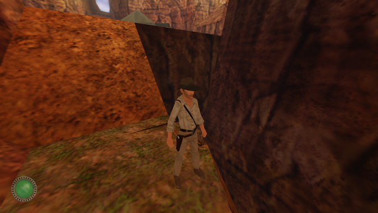
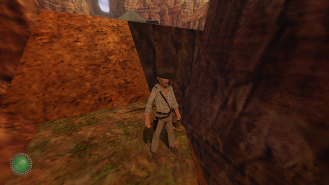
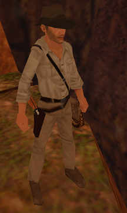
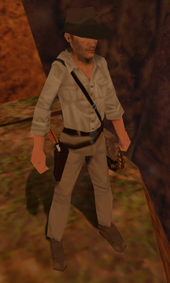
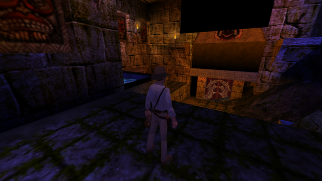
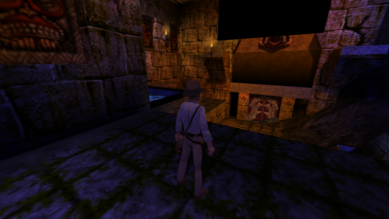
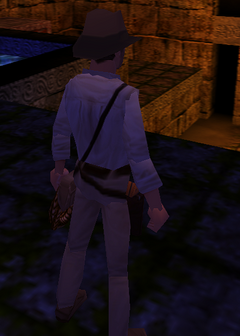
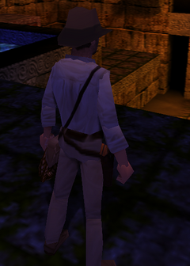
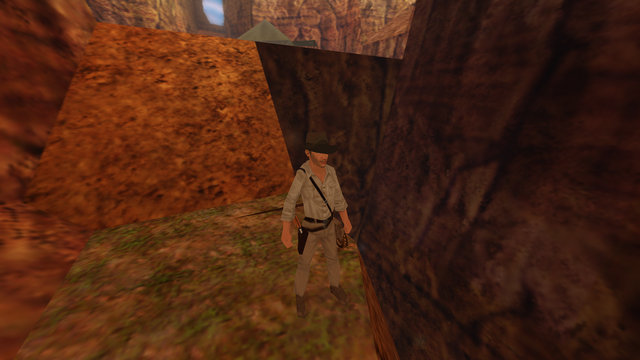
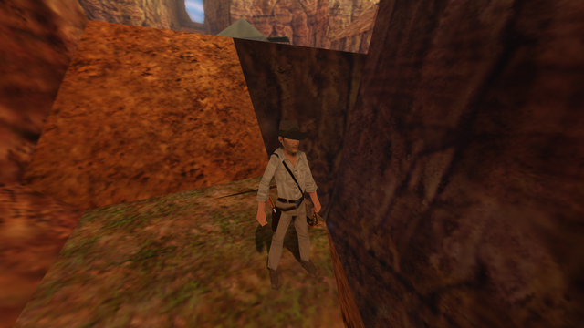

# M11.1: contact shadows

Frames from the windowed Babylon build of branch `m11.1` (after `1cb13bba`) on Xvfb (1920x1080) with Mesa
lavapipe, the Enhanced defaults, and only `engine.renderer.contactShadows` switched between the columns. Recorded
2026-11-26 and approved by the owner the same day. Lavapipe renders on the CPU, so these show the picture, not performance. The raw BMPs contain game data
and are not committed; these are downscales and crops.

Windowed runs are not frame-exact: game time follows the wall clock, so the camera and Indy's pose drift slightly
between the Off and On run of a scene. Compare by eye, not pixel by pixel.

The light is a fixed overhead direction 35 degrees from vertical at azimuth 30 degrees (ADR-0041 item 1); only
ordinary surfaces receive (not water, sky or empty pixels), and the first-person overlay is left alone. Effect
settings: ray length 0.2, thickness 0.04, strength 0.7, 16 steps, a 4 x 4 ordered jitter removed by a depth-aware
4 x 4 blur (`babylon::postfx::ContactShadowEffect`, ADR-0043).

| Scene | Off | On |
| --- | --- | --- |
| Regress (present 1200 of `regress.nds`) |  |  |
| Regress, Indy |  |  |
| Volcano start (present 1500 of `start_06_VOLCANO.nds`) |  |  |
| Volcano, Indy |  |  |
| Canyon start (present 2100 of `start_01_CANYON.nds`) |  |  |

What to look at: in the regress crop the hat brim now shades Indy's face softly, and a soft shadow falls on the
ground beside his legs, on the side away from the light. Open floor and walls away from occluders are unchanged.
At full-frame size the effect is subtle; strength and ray length are the knobs.

Not shown: the lagoon and temple scenes (no saves for them in the test set), and shadows toward dynamic lights
(torches), which move to M11.4 with the cube shadow maps.

An earlier version (one pass with per-pixel random jitter) drew the brim shadow as a hard dither pattern; that was
replaced before these frames.
