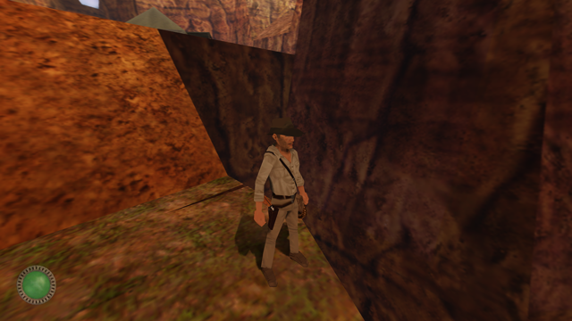
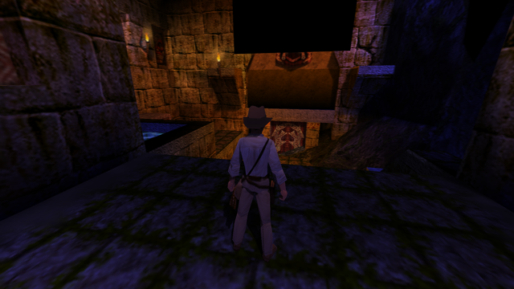

# M11.2: character shadows (for review)

Frames from the windowed Babylon build of branch `m11.2` (after `1345ee1b`, M11.2e) on Xvfb (1920x1080) with Mesa
lavapipe, the Enhanced defaults (contact shadows on in both columns), and only `engine.renderer.shadows` switched.
Recorded 2026-11-26, re-recorded after the first review. The raw BMPs contain game data and are not committed; these are downscales and crops.

Windowed runs are not frame-exact: game time follows the wall clock, so the camera and Indy's pose drift slightly
between the Off and On run of a scene. Compare by eye.

The light is the M11.1 overhead light (35 degrees from vertical, azimuth 30). Casters are the things that had the
original blob shadow (Indy, enemies, animals); with shadows on, the blob is not drawn for them. A 2048 x 2048
orthographic shadow map is fitted around the casters each frame and applied to ordinary surfaces with 12-tap PCF
(strength 0.55), after the contact shadows and before ambient occlusion (ADR-0041 amendment, ADR-0043).

| Scene | Off | On |
| --- | --- | --- |
| Regress (present 1200 of `regress.nds`) |  |  |
| Regress, Indy |  |  |
| Volcano start (present 1500 of `start_06_VOLCANO.nds`) |  |  |
| Volcano, Indy |  |  |
| Canyon start (present 2100 of `start_01_CANYON.nds`) |  |  |

**First review (2026-11-26): rejected.** The shadow stopped at the head and the ground shadow broke into shards
pointing in different directions. Cause: the casters were the triangles std3D drew, and rdroid culls back faces
before they reach std3D, so the caster was the half shell facing the camera; seen from the light it has holes. Since
M11.2e, rdModel3 passes every face of a caster model (back faces included) through `std3D_AddShadowCasterPolygon`.
One frame's casters, rendered flat from the camera (left half) and from the light (right half):

| Before (draw path) | After (M11.2e) |
| --- | --- |
|  |  |

What to look at: in the regress crop Indy casts one connected body-shaped shadow on the ground to his left (away
from the light) and the hat shades his whole face evenly. In the volcano the floor is so dark that the shadow is hard to see; that is the
scene's lighting, not a missing shadow.

Questions for review: strength (0.55) and softness (PCF radius 1.5 texels); whether the shadow should also fall on
the walls next to Indy (it does, on ordinary surfaces, within the map); and whether to keep contact shadows on as
well (they overlap where the character shadow falls).

Known limits: the map's texel size follows the casters' bounds, so shadow edges can shimmer slightly while Indy
animates (to be quantized); level geometry does not cast yet (M11.3); torches and the lighter do not cast (M11.4).
