# M11.2: character shadows (for review)

Frames from the windowed Babylon build of branch `m11.2` (after the M11.2g caster mask) on Xvfb (1920x1080) with
Mesa lavapipe and the Enhanced defaults (contact shadows on in every column). Recorded 2026-11-26, third round. The
raw BMPs contain game data and are not committed; these are downscales and crops.

Each row's three columns are **consecutive frames of one run** (a throwaway build switched the mode every frame),
so Indy's pose, the camera and the light are the same in all three. Earlier rounds compared separate runs, which
drift (game time follows the wall clock) and were misleading.

- **Off**: character shadows off (contact shadows only).
- **Self-shadowing**: character shadows as in the second review: Indy also receives his own shadow (the hat band
  on the face).
- **On**: what M11.2 ships now: characters cast the shadow onto the world but do not receive it themselves.

The light is the M11.1 overhead light (35 degrees from vertical, azimuth 30). Casters are the things that had the
original blob shadow (Indy, enemies, animals); with shadows on, the blob is not drawn for them. A 2048 x 2048
orthographic shadow map is fitted around the casters each frame and applied to ordinary surfaces with 12-tap PCF
(strength 0.55), after the contact shadows and before ambient occlusion (ADR-0041 amendment, ADR-0043).

| Scene | Off | Self-shadowing (2nd review) | On |
| --- | --- | --- | --- |
| Regress (present 1200 of `regress.nds`) |  | 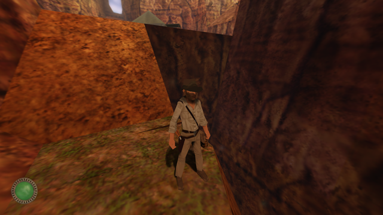 |  |
| Regress, Indy |  | 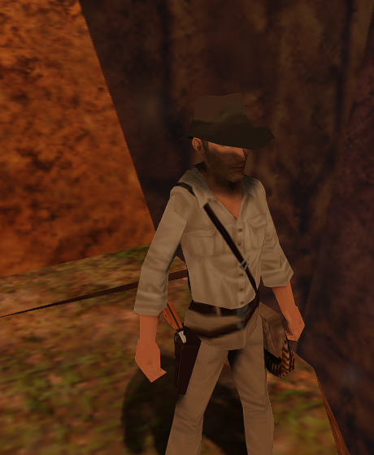 | 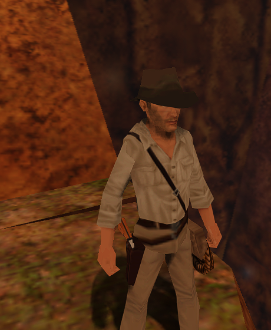 |
| Canyon start (present 2100 of `start_01_CANYON.nds`) |  | 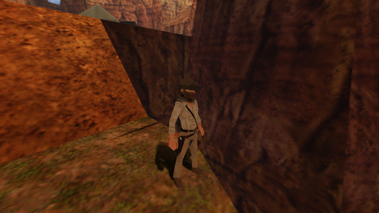 | 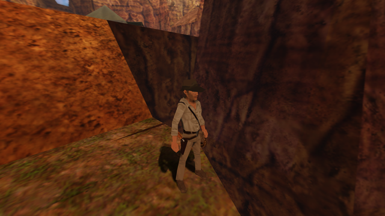 |
| Canyon, Indy | 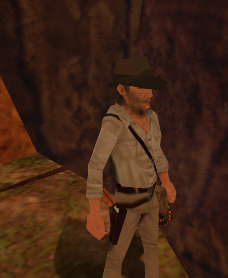 | 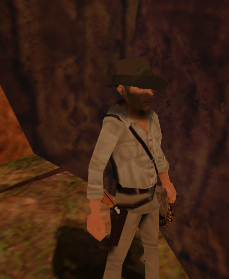 | 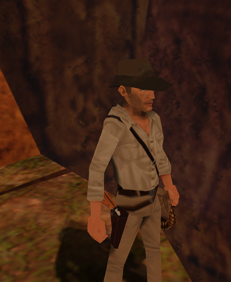 |
| Volcano start (present 1500 of `start_06_VOLCANO.nds`) | 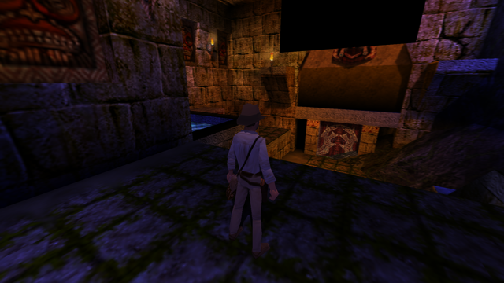 | 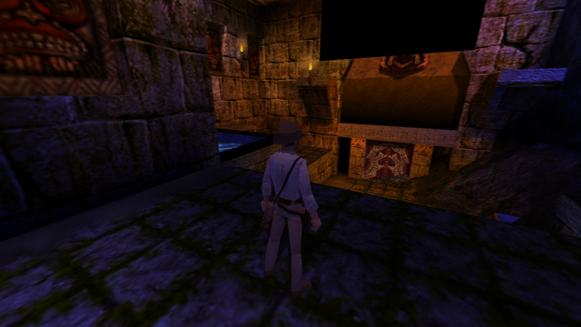 |  |
| Volcano, Indy | 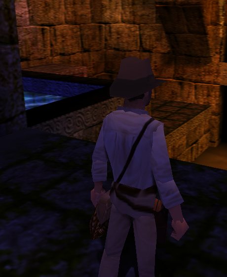 | 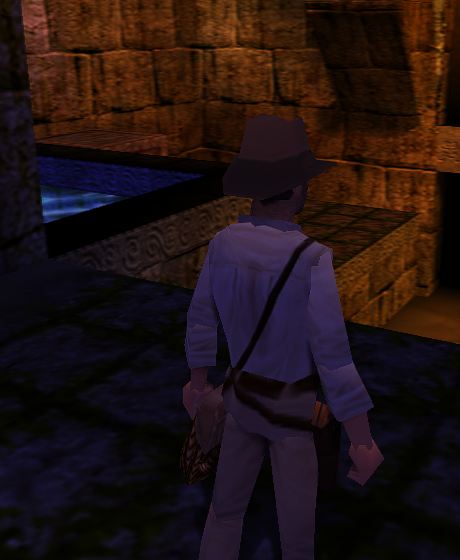 | 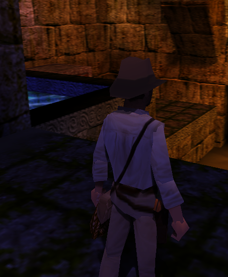 |

What to look at: in the On column Indy's face and body look exactly as in Off, and one connected body-shaped shadow
lies on the ground beside him (away from the light). In the volcano the floor is so dark that the shadow is hard to
see; that is the scene's lighting.

## Review history

**First review: rejected** (shadow stopped at the head, ground shadow in shards "from different directions").
Cause: the casters were the triangles std3D drew, and rdroid culls back faces before they reach std3D, so the caster
was the half shell facing the camera; seen from the light it has holes. Since M11.2e, rdModel3 passes every face of a
caster model (back faces included) through `std3D_AddShadowCasterPolygon`. One frame's casters, rendered flat from
the camera (left half) and from the light (right half):

| Before (draw path) | After (M11.2e) |
| --- | --- |
| 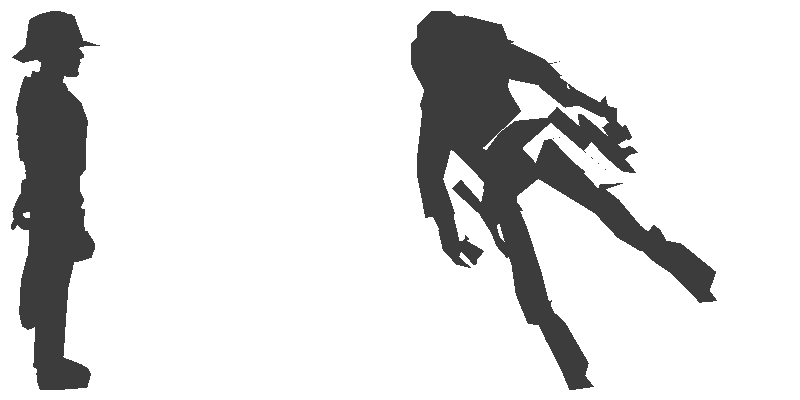 | 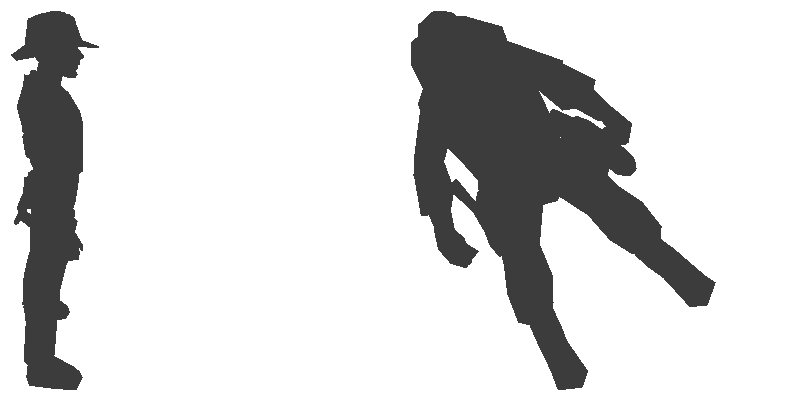 |

**Second review: rejected** (the face band "looks like a mask, not a shadow"). Since M11.2g a caster-mask pass
re-draws the caster draws against the scene depth into a small mask, and the receive pass leaves those pixels
unchanged: characters cast but do not receive. M11.3 uses the same mask inverted, so level geometry can shadow
characters.

Questions for review: strength (0.55) and softness (PCF radius 1.5 texels); whether the shadow should also fall on
the walls next to Indy (it does, on ordinary surfaces, within the map).

Known limits: level geometry does not cast yet (M11.3); torches and the lighter do not cast (M11.4); things outside
the view frustum do not cast.
