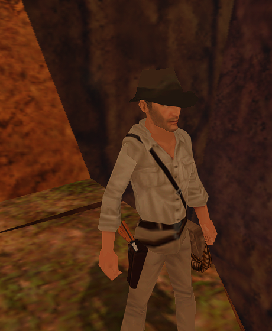
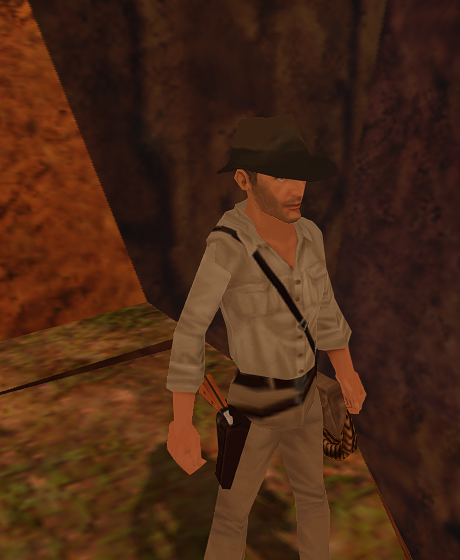
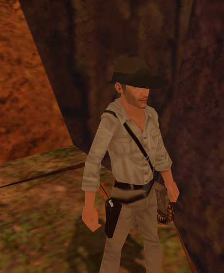
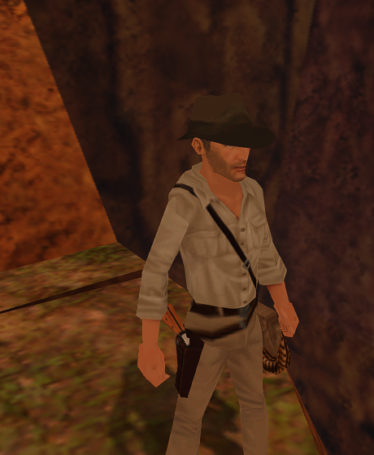
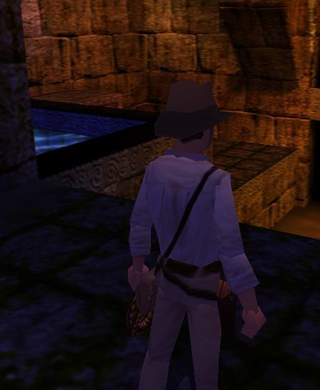
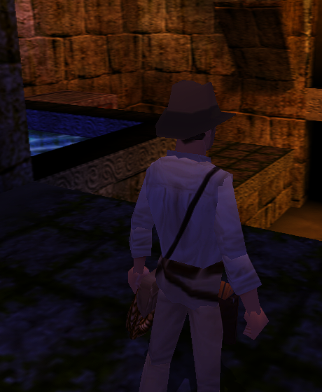
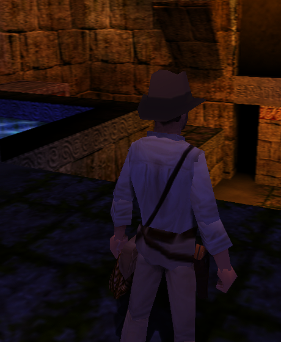
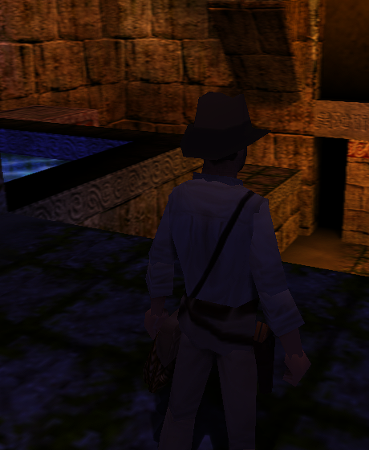

# M11.3: level geometry shadows the characters (for review)

Branch `m11.3` (on top of `m11.2`). Frames from the windowed Babylon build on Xvfb (1920x1080) with Mesa lavapipe and
the Enhanced defaults. Each pair is **two consecutive frames of one run**; a throwaway build switched only the level
shadow pass every frame and logged which mode each screenshot used. Recorded 2026-11-26. Crops only; the raw BMPs
contain game data and are not committed.

## What it does

The level's surfaces are uploaded once per level (`sithRender_Open` -> `std3D_SetStaticShadowCasters`). Each frame a
second 2048 shadow map from the same overhead light draws them, fitted around the characters (a fit-only batch), and
a second receive pass applies it **only on the characters** (the M11.2 caster mask in include mode). The level's
baked lighting already contains its own shadows, so the world receives nothing from it. Owner decision: only
`SITH_TF_SHADOW` things receive (Indy, enemies, animals).

Only **up-facing** surfaces cast (the top of a ledge, an overhang, a bridge). A room's ceiling faces down into the
room; when ceilings cast, every indoor character went fully dark (first version, below).

## Frames

| Scene | Level shadows off | Level shadows on |
| --- | --- | --- |
| Regress (present 1200) |  |  |
| Canyon start (present 2100) |  |  |
| Volcano start, indoors (present 1500) |  |  |

All three pairs look the same, which is correct: nothing in these spots hangs between Indy and the overhead light.
**These saves can't show the effect.** A save with Indy under a ledge, bridge or overhang (outdoors) is needed; the
GPU test (`LevelGeometryShadowsTheCharacterButNotTheWorld`) shows a ledge darkening a character and not the floor.

The first version, where ceilings also cast (volcano, before M11.3d):

| Off | Ceilings casting (fixed) |
| --- | --- |
|  |  |

## Questions for review

1. Is a save under a ledge or overhang available (or a place to walk to from one of the start saves) for real frames?
2. Indoor rooms below an up-facing floor of another room can still shadow characters if that floor is within
   `staticReach` (1.5 units, about 7 character heights) above them. Keep, shorten, or limit level shadows to sectors
   open to the sky?

Known limits: doors, lifts and other moving geometry are things (3DO), not level surfaces, and don't cast yet; things
outside the view frustum don't receive.
