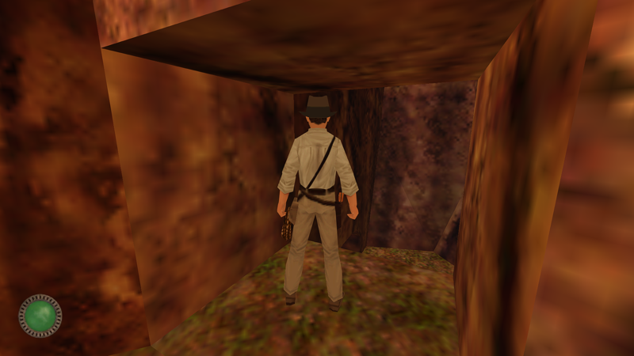
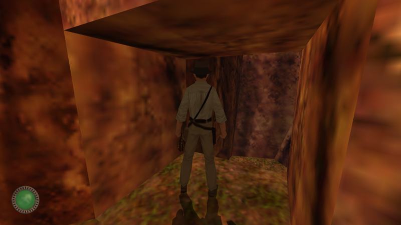
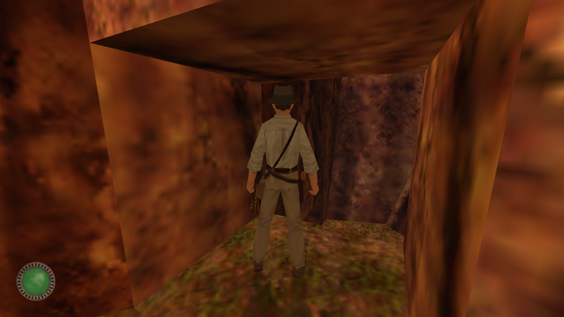
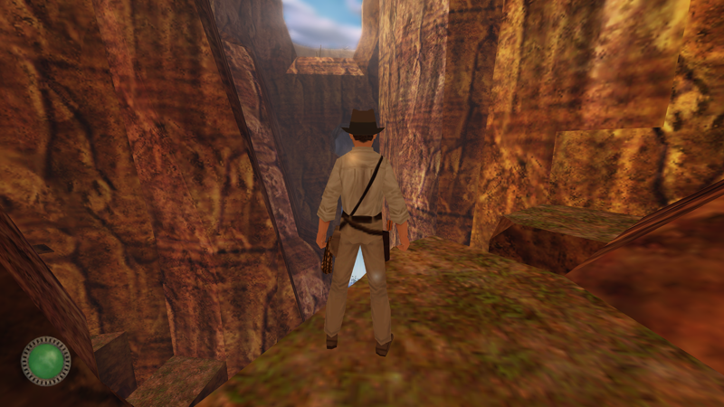
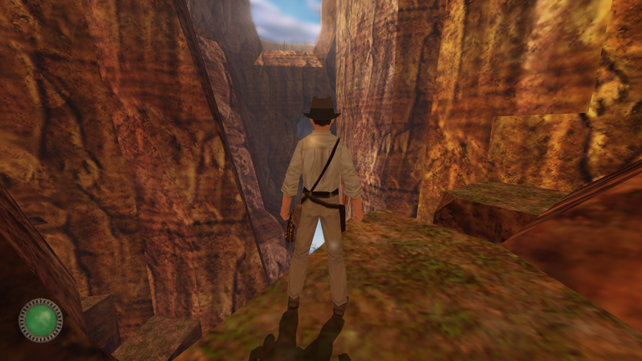
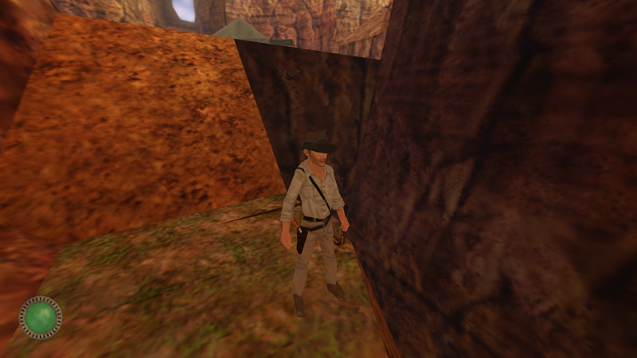
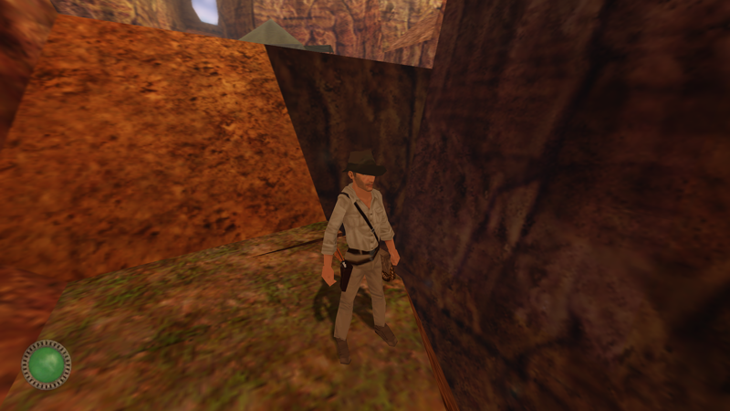
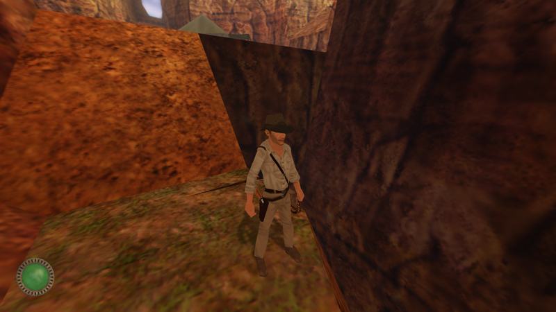
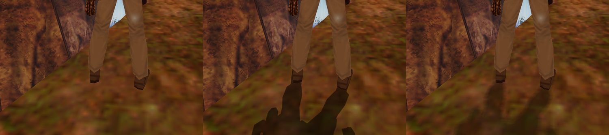

# M11.6: gentler, softer, stable shadows (bug 38, for review)

Branch `m11.3` (includes `m11.2`). Owner play-test after the contact-shadow fix: shadows too strong in parts, razor
sharp, odd far-away shadows, shadows changing with the view. Causes and ranked fixes: a review on 2026-11-26
(`.claude/reviews/shadows-2026-11-26/README.md`, local). What changed:

- **Strength:** character shadow 0.4 (was 0.55), contact shadows 0.5 (was 0.7), level shadow 0.3 (was 0.55).
- **Soft edges in world units:** 0.002 view units, widening by 0.03 per unit the receiver lies behind the caster;
  the shadow fades out 0.3 to 1.0 units behind the caster (no more full, sharp silhouettes on far receivers).
- **Realistic fades:** shadows fade between 3 and 6 view units from the camera (contact 2 to 4); they were 20/40 and
  30/60, i.e. never, at this game's scale (Indy is about 0.2 units tall).
- **Dark areas:** surfaces darker than a luminance of 0.03..0.25 get proportionally less shadow, so torch-lit and dim
  interiors don't get a hard sun shadow.
- **Stable with the camera:** both shadow maps are now fitted in the world (fixed light basis, snapped in world space),
  so turning the camera no longer turns the texel grid or changes the map size. Character casters in front of the map
  are no longer clipped; for level casters the 1.5-unit reach is a hard limit, now independent of the camera.

Frames: windowed Babylon build, Xvfb 1920x1080, Mesa lavapipe. Each row is **three consecutive frames of one run**
(a throwaway build switched the mode every frame and logged it): shadows off / the previous values / the new values.
The world-anchored fit is in both "before" and "after" (it can't be switched per frame); it shows only while moving.

| Spot | Off | Before (M11.2/M11.3 values) | After (M11.6) |
| --- | --- | --- | --- |
| Under the overhang (`dsadm.nds`, owner) |  |  |  |
| Open ledge (`QUICKSAVE.nds`, owner) |  |  |  |
| Regress (present 1200) |  |  |  |

Indy's feet on the ledge, full resolution (off / before / after):

Questions for the owner's GPU check: is the character shadow now too faint (strength 0.4 times the dark-area gate)?
Do shadows still change with the view or pop while walking? Is the faint line moving with Indy gone?
