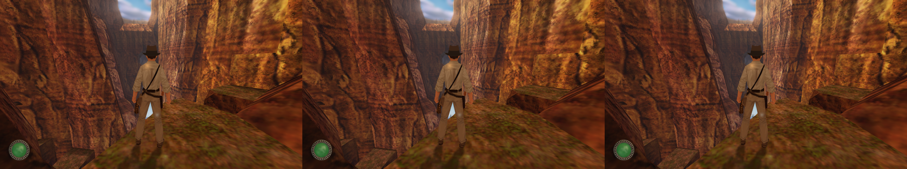
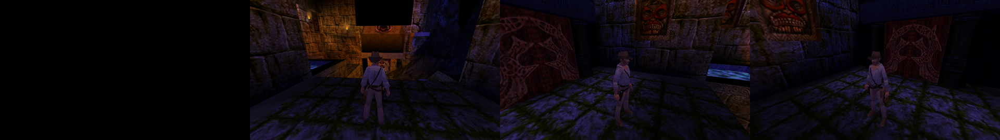

# M11.7: scripted test drive and contact shadows at contact range (for review)

Branch `m11.3` (includes `m11.2`). Owner review 2026-11-27 (`light_2.webm`): contact shadows still made large dark
patches that changed as the camera circled; and in the volcano, circling the camera, the scene "was re-rendered very
small, just flashed" for one frame.

## Contact shadows
Their ray reached 0.2 view units, a whole character height (Indy is about 0.2 units tall), so they darkened big
screen-space regions that change with the view. Now 0.04 units with a 0.02 thickness (M11.7c): only corners and contact
points darken. On the owner's open ledge (one run, consecutive frames: reach 0.2 / 0.05 / 0.03) the remaining contact
shadow is subtle at every reach:

## Volcano flash: test drive
A scripted test drive (windowed build under Xvfb, Mesa lavapipe, 960x540) orbited the camera with relative mouse
motion in the volcano start, slow (300 + 280 frames) and fast with pitch (580 frames), and saved **every frame**. A
scan compared each frame with both neighbours (a one-frame "small scene" would differ sharply from both while the
neighbours match each other). **Not reproduced:** 1200 frames, nothing flagged. Four frames of the slow orbit:

So the flash is either specific to the owner's GPU/driver or needs another trigger (menu, resize, a cut, a frame-rate
spike). A short video with the flash, or a render capture of the owner's session (not built yet), would settle it.

Known limit of the test drive: mouse orbiting moved the camera in the volcano save but not in the two owner saves
(dsadm, QUICKSAVE); not investigated.
