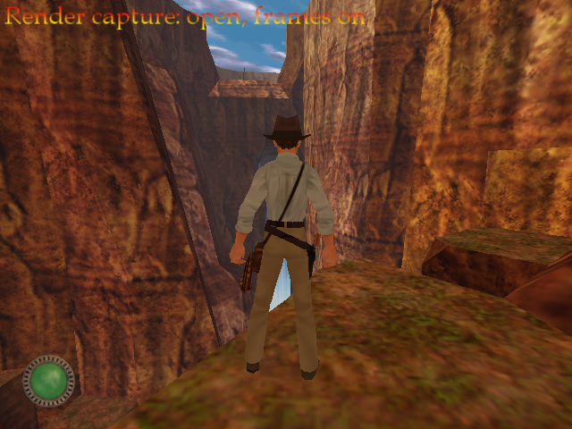
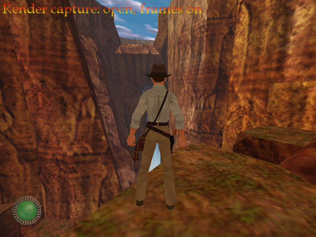
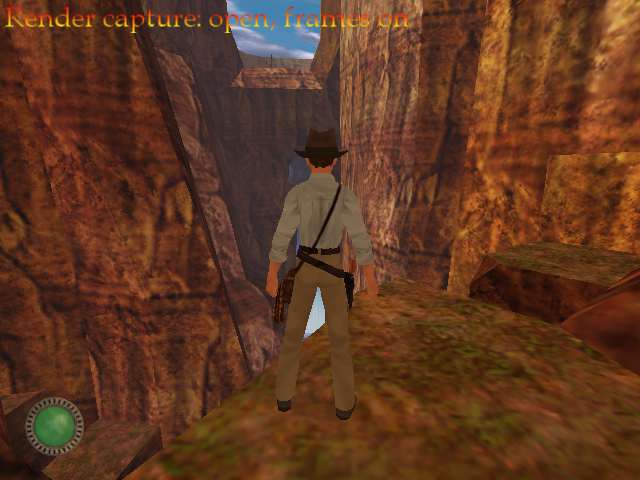
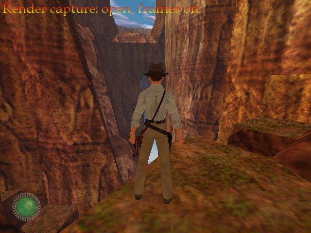
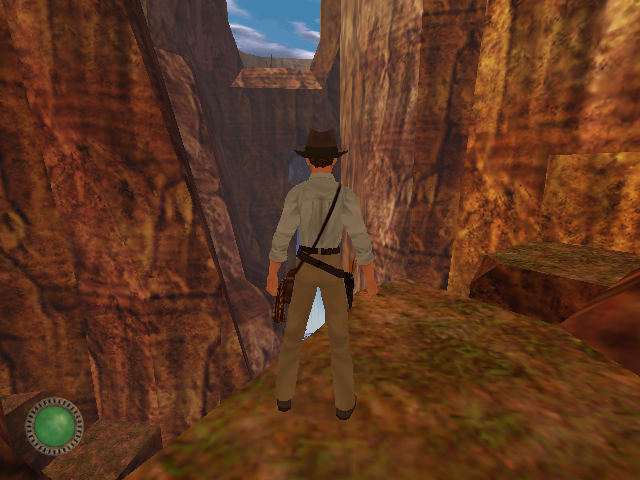
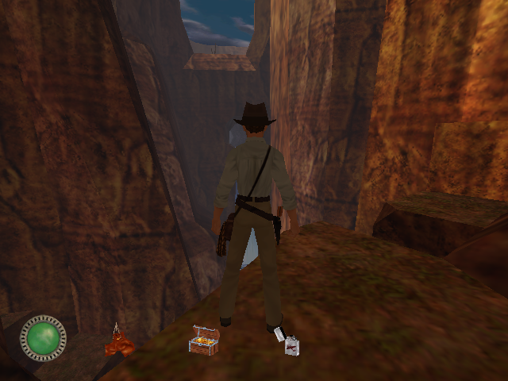
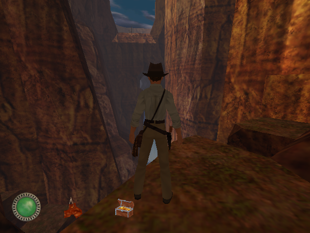
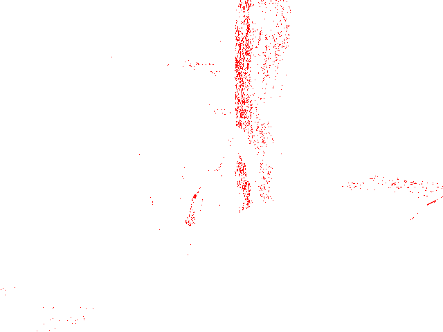

# M6.6 progress: the 3D scene on the Babylon renderer

Frames of the M6.1 `canyon` capture, replayed through the Babylon column's `std3D` on SDL GPU (Vulkan on Mesa
lavapipe, no window) with `Jones3D-replay --render gpu --frames-out`, beside the DX9 screenshots recorded in M6.1
(wine, wined3d on llvmpipe). Each DX9 screenshot is paired with the replayed frame that matches it best; the
screenshots are taken by time, so the pairing is by image, not by frame number.

Recorded 2026-11-06 on `m6-babylon-renderer` at `4010d1bc`.

| DX9 (M6.1) | Babylon (M6.6) | PSNR | Pixels differing by more than 3% |
|---|---|---|---|
|  |  | 44.5 dB | 0.77% |
|  |  | 44.6 dB | 0.75% |
|  |  | 44.2 dB | 0.77% |
|  |  | 44.8 dB | 0.48% |
|  |  | 45.8 dB | 0.42% |
|  |  | 44.5 dB | 0.77% |

Where the first pair differs (red: more than 3% apart), mostly along one rock edge and a few polygon edges, where
texture filtering and rasterization rules of wined3d and lavapipe differ:

## Not in these frames

- The 2D layer: console text (for example the "Render capture: open, frames on" line in the DX9 shots), HUD text
  and menus are drawn through `stdDisplay`, which was still the Null display at M6.6.
- The `intro` and `indoor` captures stopped at a `stdDisplay` record in the replay, so they rendered after M6.7.
- The owner reviewed this page and the M6.7 to M6.9b pages in the M6.9 parity review.
