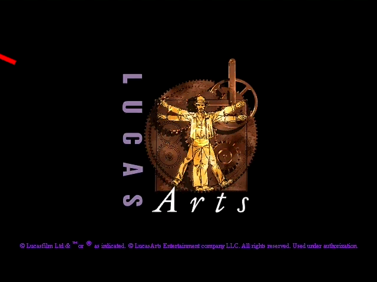
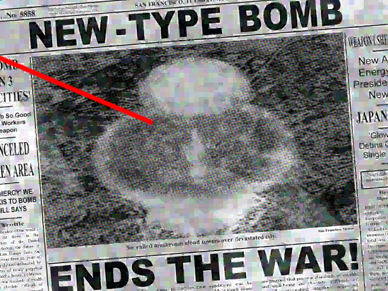
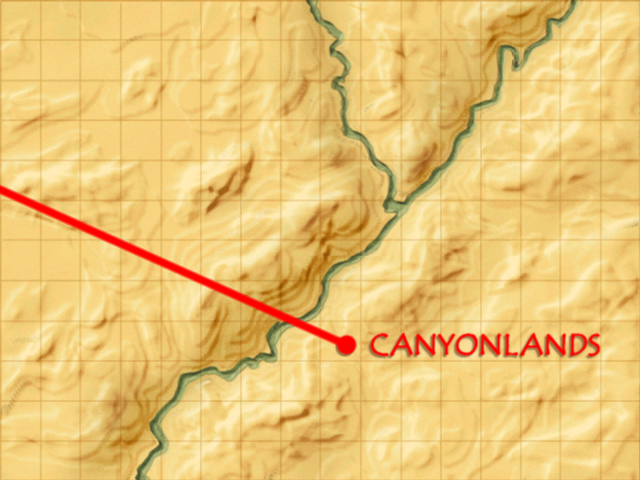

# M6.8 progress: the game plays its intro movie on the Babylon renderer

Unlike the M6.6 and M6.7 pages, these frames don't come from a DX9 capture: the game itself played the intro
movie (`jonesopn.snm`) in the Babylon column, through the silent SMUSH sound driver and the polled timer (M6.8),
drawing each movie frame into the back buffer through `stdDisplay`. The run was `Jones3D-headless --render gpu
--capture` with `startMode` 0 (SDL GPU on Mesa lavapipe, no window); the capture was then rendered with
`Jones3D-replay --render gpu --frames-out --every 20`. It holds 2,034 frames, close to the 2,014 of the DX9 intro
capture of M6.1, and replays with no mismatch. Sound is silent until M7.

Recorded 2026-11-06 at `3e51cdc4` (M6.8).

| Frame | |
|---|---|
| 0 (black: the movie fades in) |  |
| 160 (the red map line at the top left is in the movie: the DX9 capture shows it from frame 144 on) |  |
| 320 |  |
| 640 |  |
| 960 |  |
| 1440 |  |
| 1920 |  |
