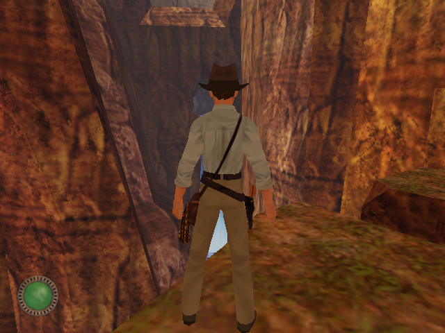
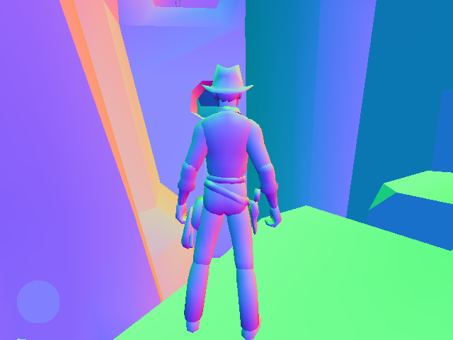

# M6.9b progress: view-space normals in the normal target

With `engine.renderer.litFaces.enabled` on (the default), world surfaces and models reach the renderer with
view-space normals, which fill the normal target that per-pixel lighting and SSAO will read later (M10). Level
vertex normals are smoothed at load across edges under 45 degrees; models use their own vertex normals. The colour
image doesn't change: frames rendered with the option on and off are byte-identical.

Frames from a headless run from the `regress` savegame (`Jones3D-headless --render gpu --capture`, then
`Jones3D-replay --render gpu --frames-out --normals`, SDL GPU on Mesa lavapipe). Normals are encoded as colour:
x (right) in red, y (up) in green, z (toward the viewer) in blue, so floors are green and surfaces facing the
camera are blue-violet. The HUD stays on the classic path and shows the constant normal (0, 0, 1).

Recorded 2026-11-06 at `042c5aa8` (M6.9b).

| Colour | Normal target |
|---|---|
|  |  |
