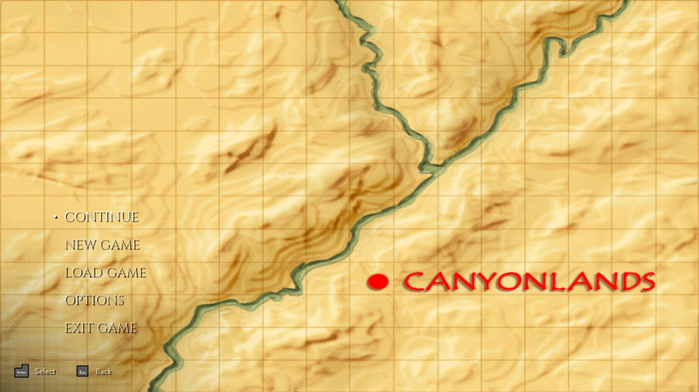
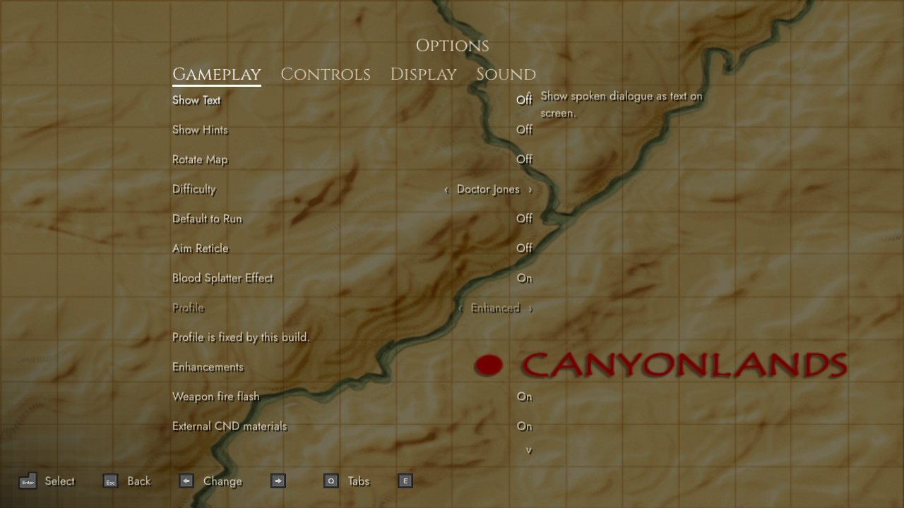
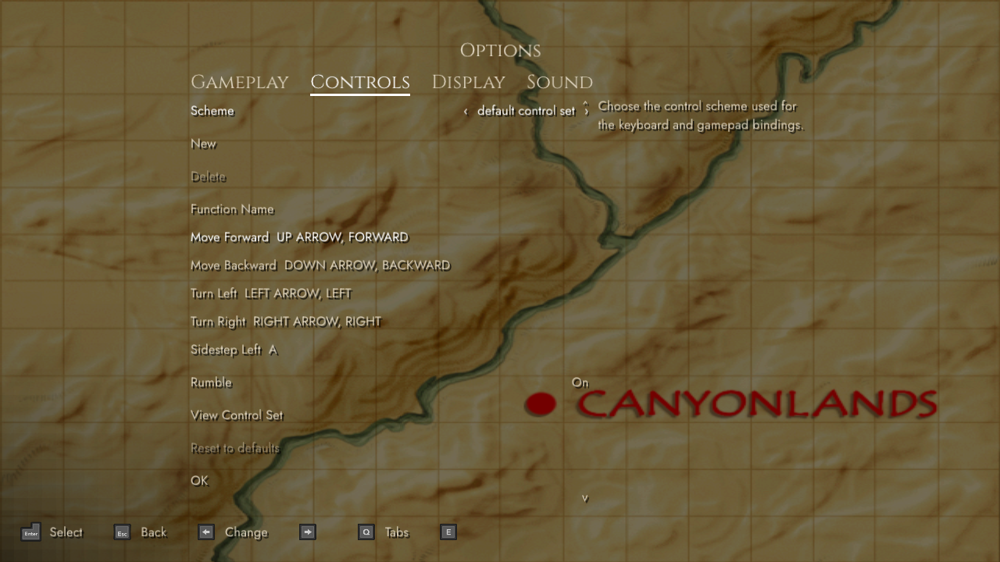
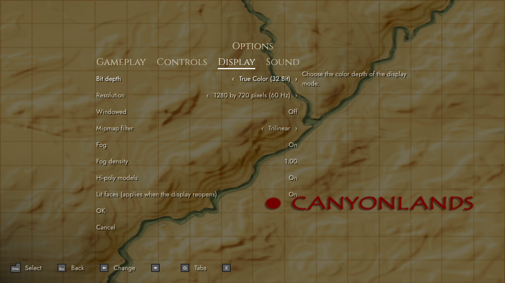
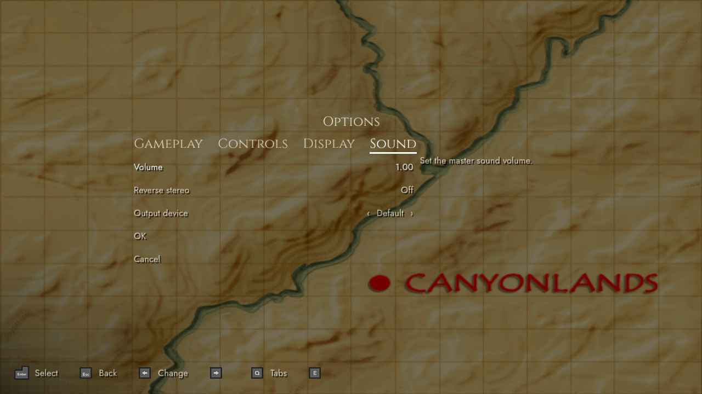
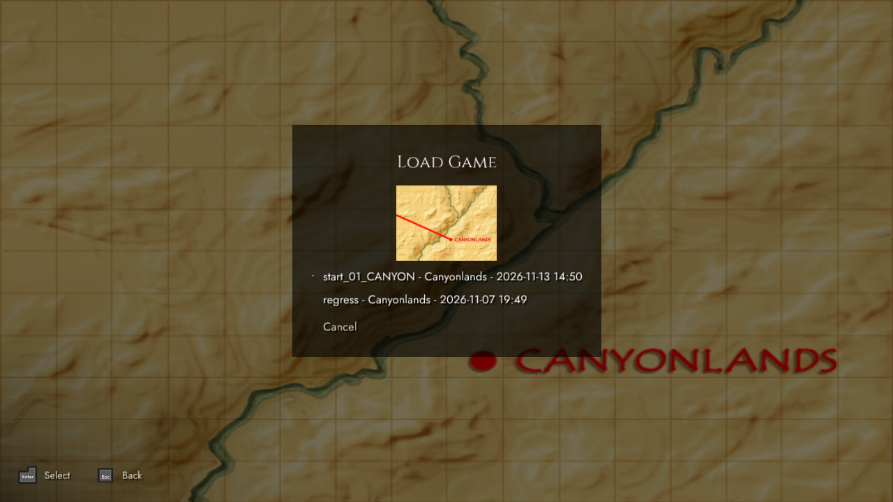
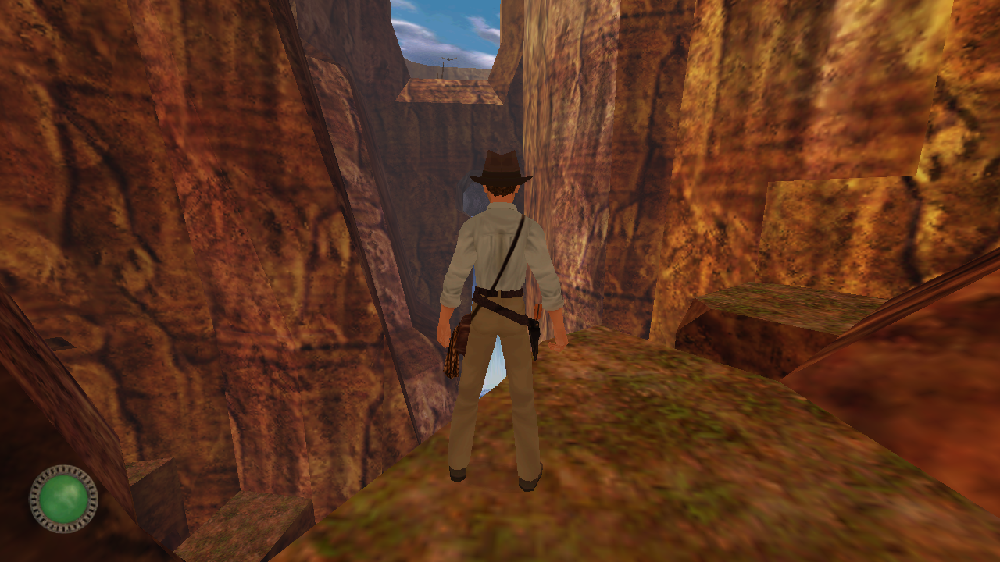
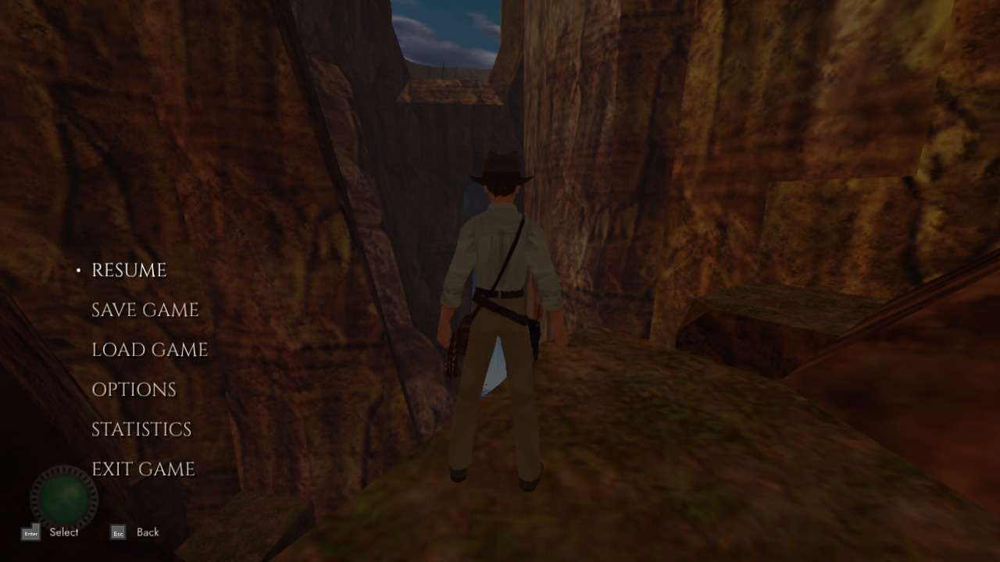
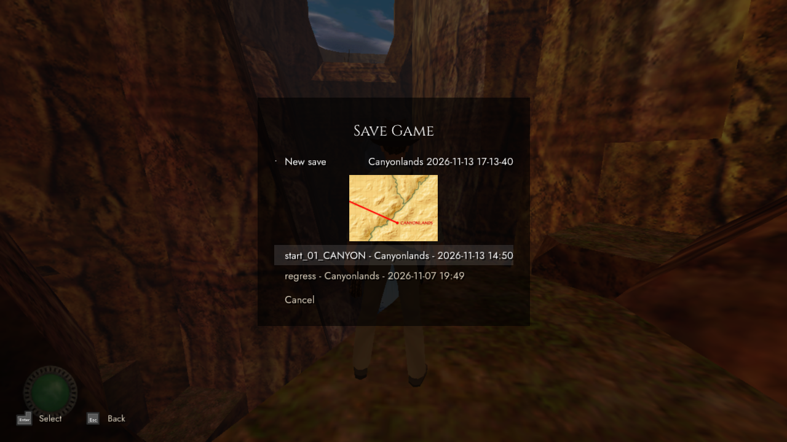
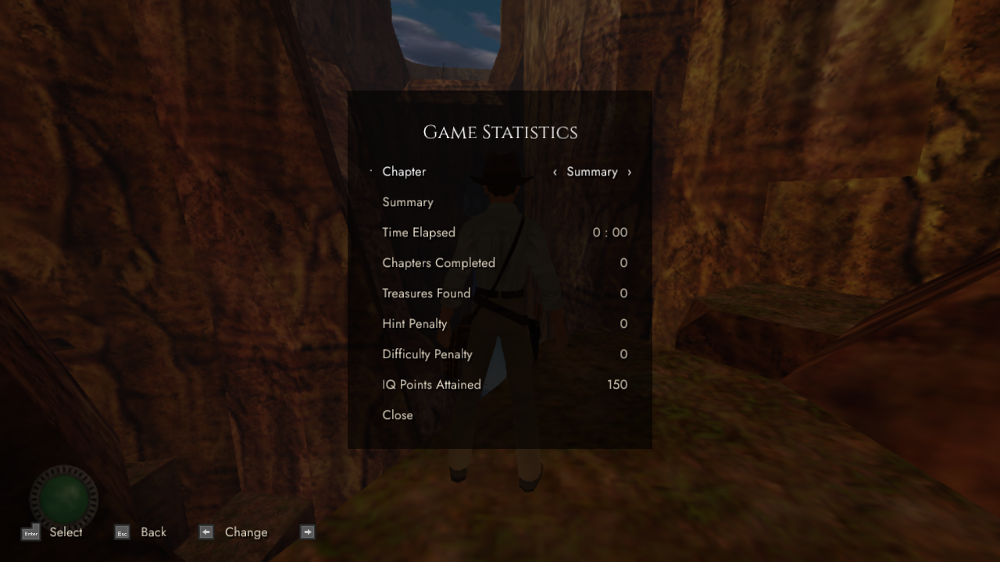

# M7.6 progress: the redesigned menus

These frames come from the windowed Babylon build `Jones3D` running offscreen
(`SDL_VIDEO_DRIVER=offscreen`, Vulkan on Mesa lavapipe) with `startMode` 5 at 1280 x 720, driven by input
scripts with `--input`, `--screenshot-dir`/`--screenshot-at` and `--present-log` (see
[Docs/Testing.md](../../Testing.md)). The in-game shots load the save `regress.nds` (Canyonlands) with `--load`.
Recorded 2026-11-13 from `m7.6-menu-redesign` (`6a80d8d8`). The menus follow [ADR-0028](../../arc42/09-decisions/ADR-0028-modern-menu-style-and-always-on-gamepad.md):
Cinzel and Jost fonts, Xelu button prompts that follow the last used device, one tabbed Options screen.

| Screenshot | |
|---|---|
| Main menu (over the load-screen map) |  |
| Options: Gameplay |  |
| Options: Controls |  |
| Options: Display |  |
| Options: Sound |  |
| Load game (from the main menu) |  |
| Gameplay (the Canyonlands level) |  |
| Pause menu (over the game) |  |
| Save game |  |
| Statistics |  |

Fixed since [M7](../M7/README.md): the Statistics labels (IQ row, level choice), the zoomed main menu map, the
separate settings screens and the Performance option are gone. The prompt bar shows keyboard icons here because
the run has no gamepad. The new labels are English.
