# M7 progress: the in-game menus on the Babylon renderer

These frames come from the windowed Babylon build `Jones3D` running offscreen
(`SDL_VIDEO_DRIVER=offscreen`, Vulkan on Mesa lavapipe) with `startMode` 5 at 1280 x 720, driven by an input
script with `--input`, `--screenshot-dir`/`--screenshot-at` and `--present-log` (see
[Docs/Testing.md](../../Testing.md)). The in-game shots load the save `regress.nds` (Canyonlands) from the
main menu. How to reproduce that run is described in the testing docs; the shots themselves were recorded
2026-11-07 at the head of `m7-playable` (`a4289b8f`).

| Screenshot | |
|---|---|
| Main menu (over the load-screen map) | 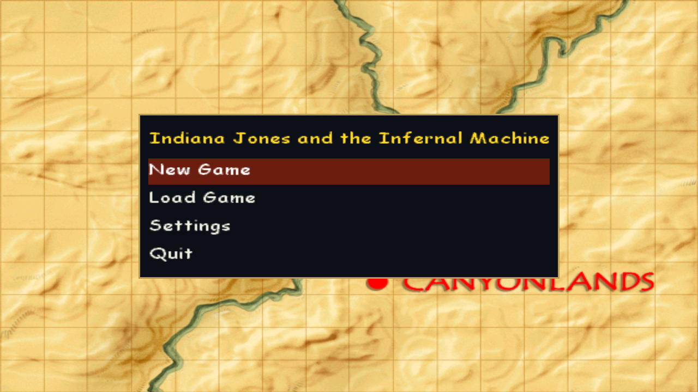 |
| Settings | 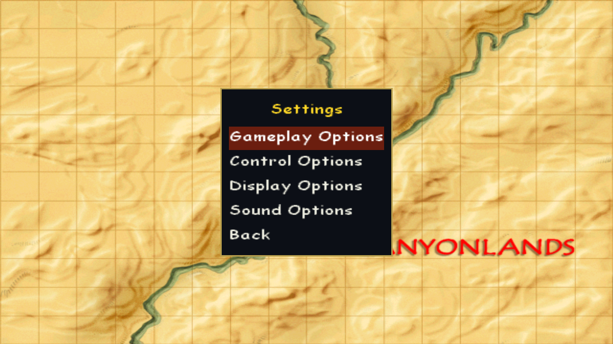 |
| Gameplay options | 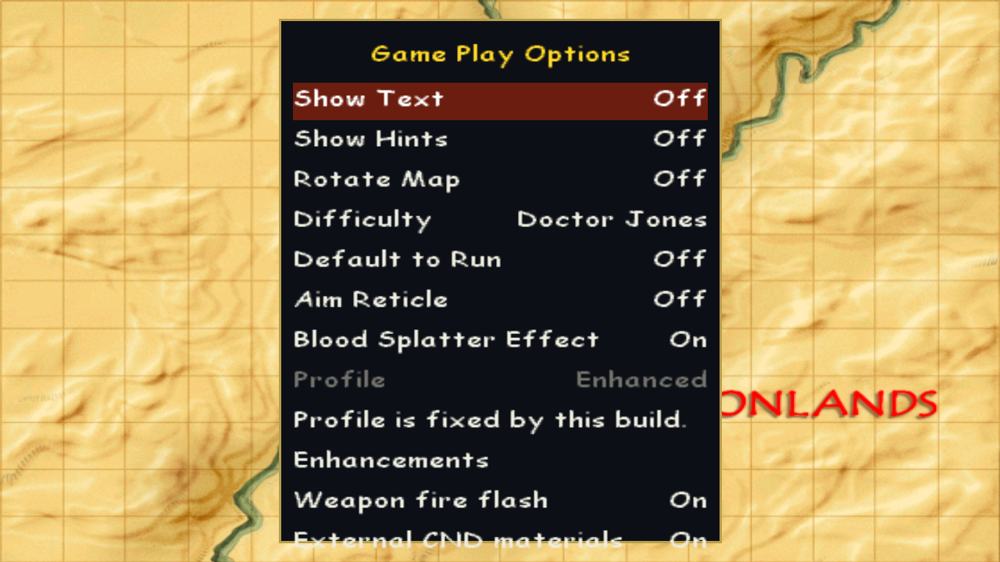 |
| Control options | 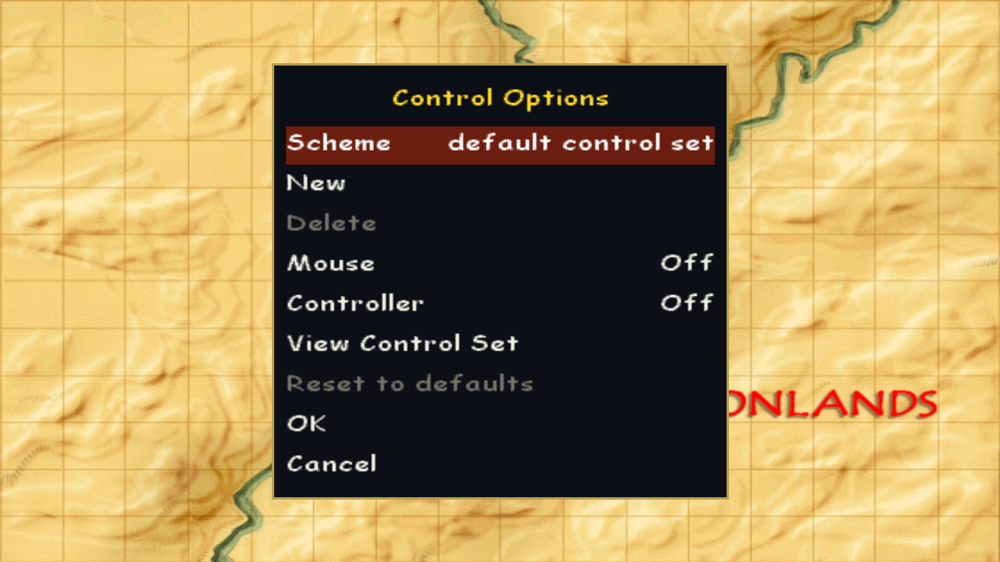 |
| Display options | 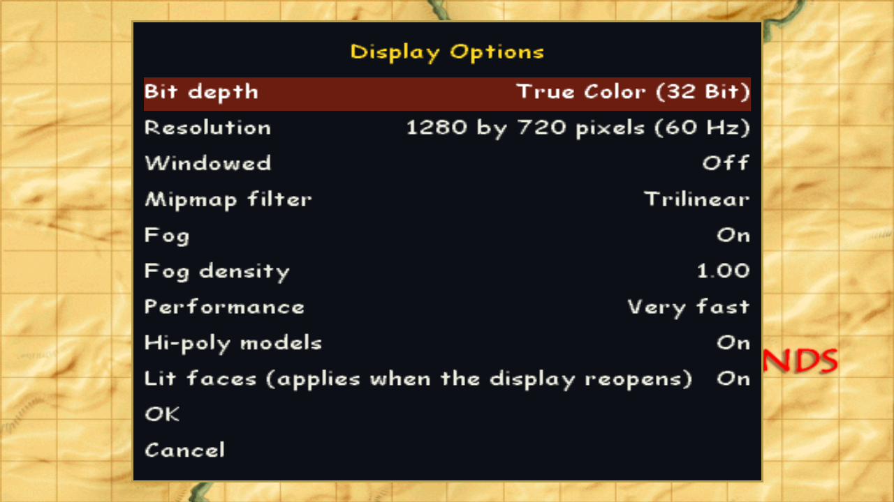 |
| Sound options | 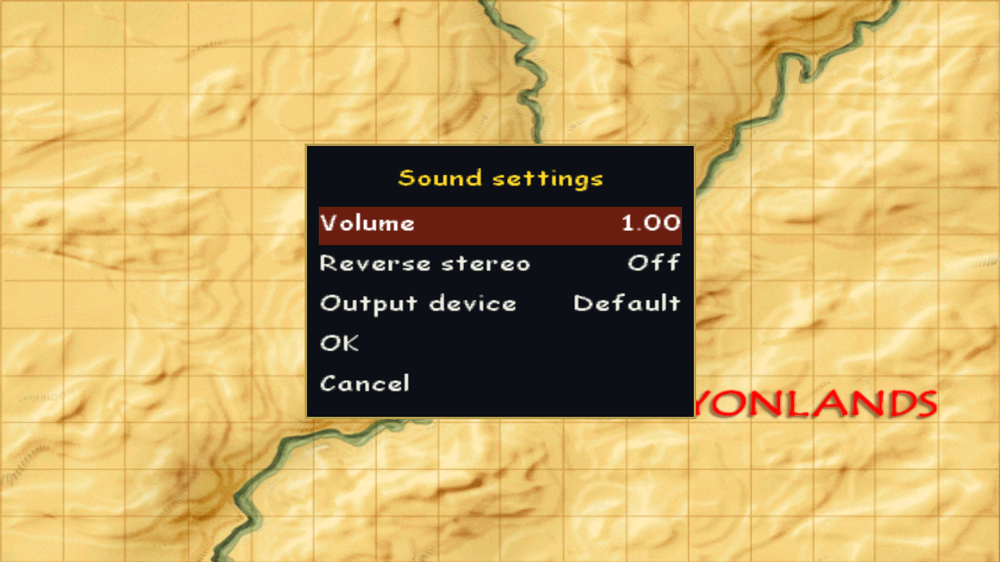 |
| Load game (over the main menu's load-screen map) | 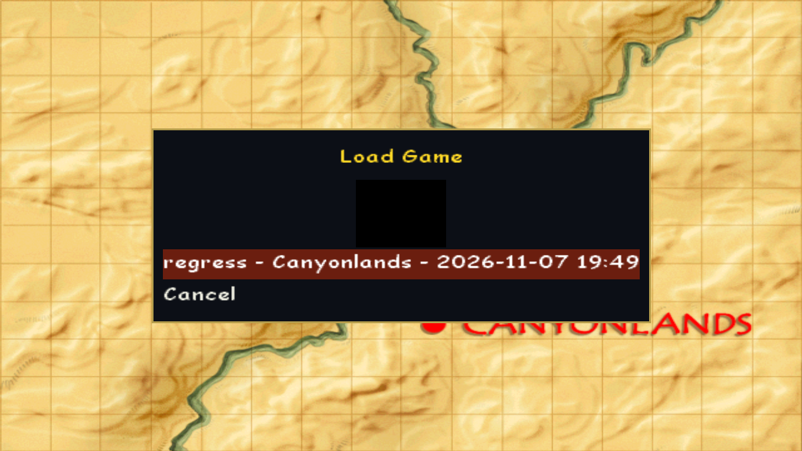 |
| Gameplay (the Canyonlands level) | 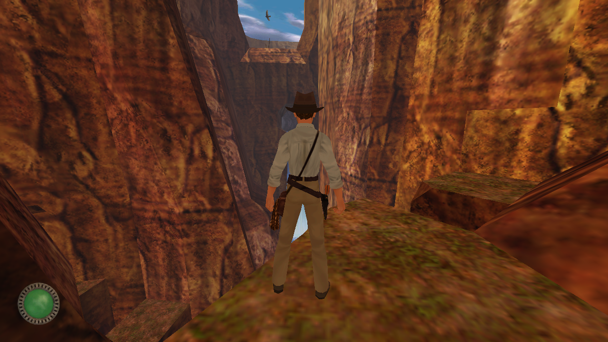 |
| Pause menu (over the game) | 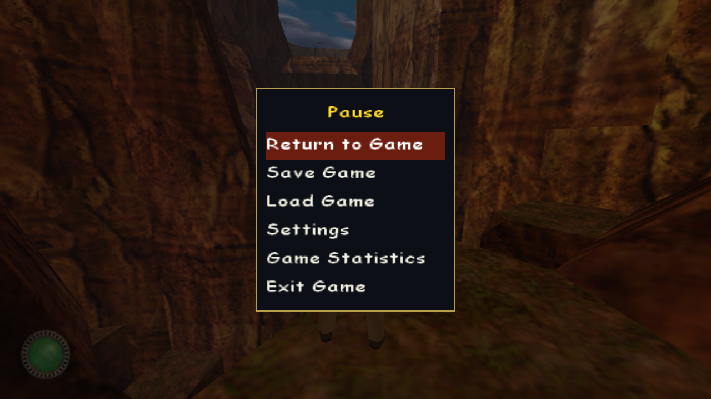 |
| Save game | 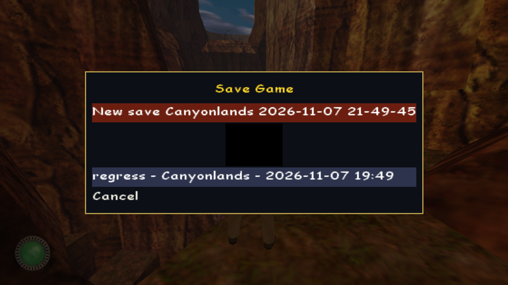 |
| Statistics (over the dimmed game frame) | 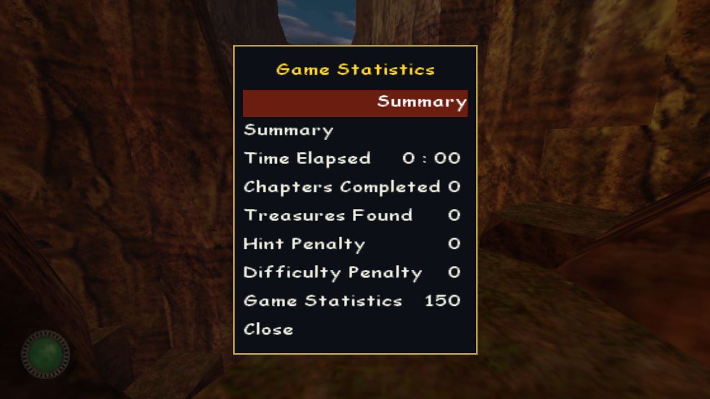 |

Known cosmetic issues:

- The Statistics screen's level choice shows an empty label, and its IQ row is labelled "Game Statistics".
- The main menu's map is a zoomed view of the load screen.
- The save `regress.nds` has an empty thumbnail (a black box); saves made in the Babylon build have real
  ones.
- The new labels are English.
