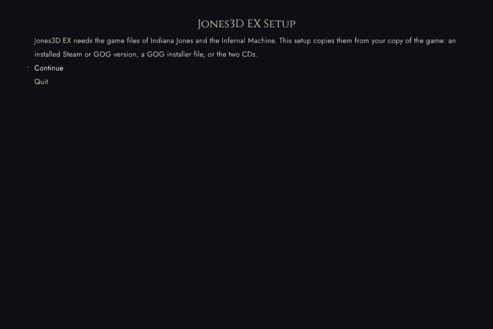
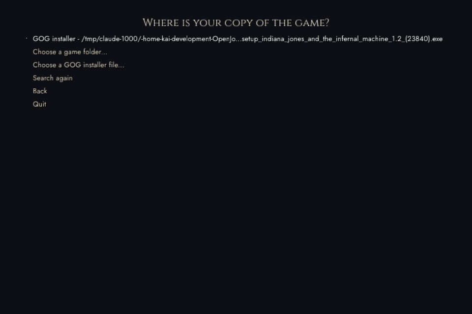
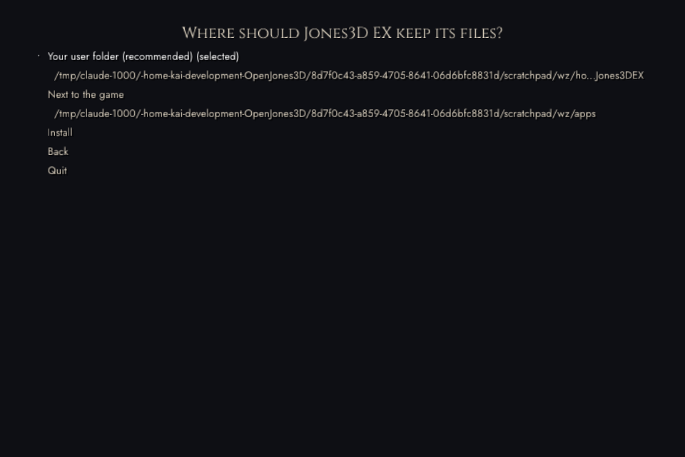
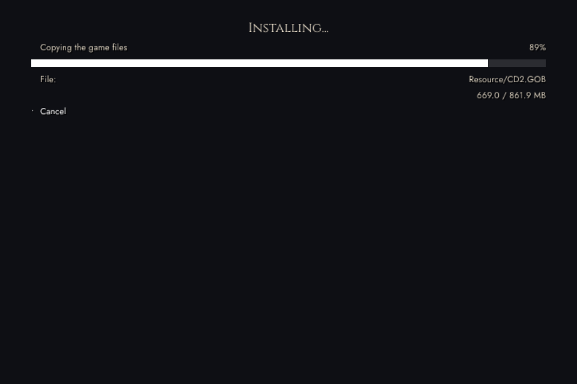
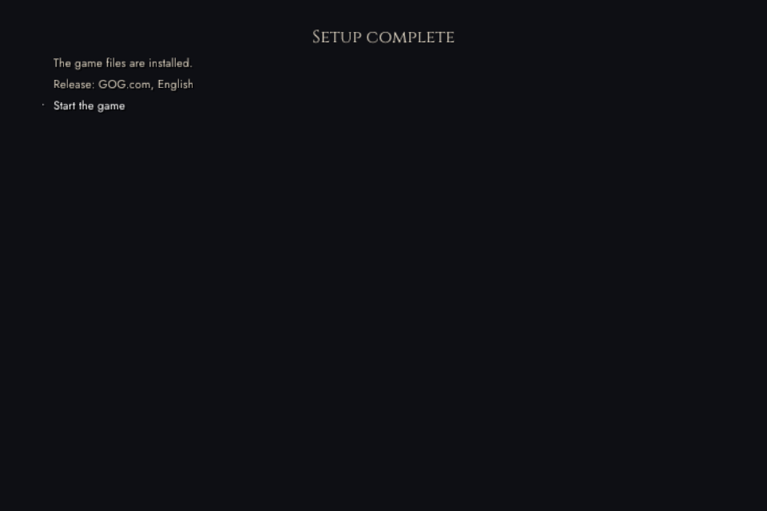
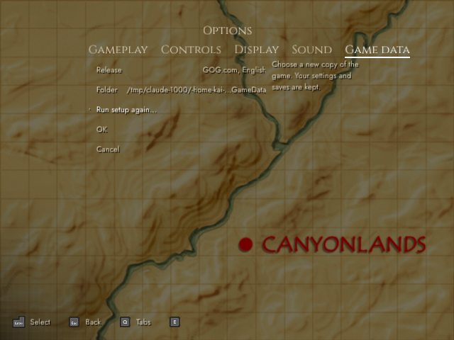

# M8 progress: the setup wizard

These frames come from the release AppImage `Jones3D_EX-0.5.0-x86_64.AppImage` (now 0.5.0-alpha) built from `m8-wizard`
(`cc0b79ee`), run on a virtual X display (Xvfb, Vulkan on Mesa lavapipe) with a fresh home folder, the GOG
offline installer in `~/Downloads` and no innoextract on `PATH`, so the bundled one unpacked it. The setup
window opens because no game data was found; [ADR-0034](../../arc42/09-decisions/ADR-0034-setup-wizard.md)
describes the flow. Recorded 2026-11-15. The licence step (the GOG EULA) is left out. The long paths are the
test machine's temporary folders.

| Screenshot | |
|---|---|
| Welcome |  |
| Source: the GOG installer found in the download folder |  |
| Location: user folder or next to the AppImage |  |
| Progress: copying after the installer was unpacked |  |
| Done: the installed data is identified |  |
| Options > Game data in the game, with "Run setup again..." |  |
