# M9 reference screenshots

Index of the M9 presentation captures. Each page records the build, save, present number and settings used,
and the frames are 640-wide downscales of windowed Babylon runs on Xvfb with Mesa lavapipe. Lavapipe renders
on the CPU, so the images show the picture, not performance.

| Page | What it shows | Thumbnail |
| --- | --- | --- |
| [Phase 1](phase1/README.md) | Output and image quality: render scale, SMAA, sharpening, anisotropic filtering, Field of view and crisp pixels. |  |
| [Widescreen](widescreen/README.md) | The hor+ cameras, the 16:9 HUD safe area and the pillarboxed intro movie at 4:3, 16:9 and 21:9. | 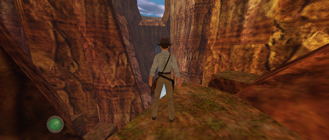 |
| [Brightness](brightness/README.md) | The brightness calibration screen shown before the main menu on a first start. | 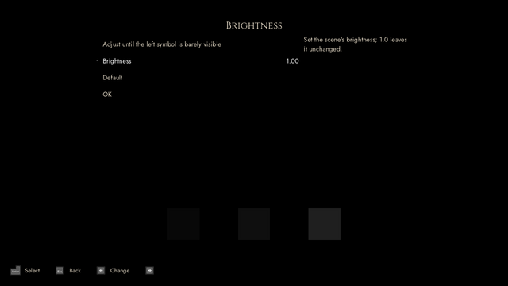 |
| [Bloom](bloom/README.md) | Bloom Off, Low and Medium, with the sky crop and mean luma. | 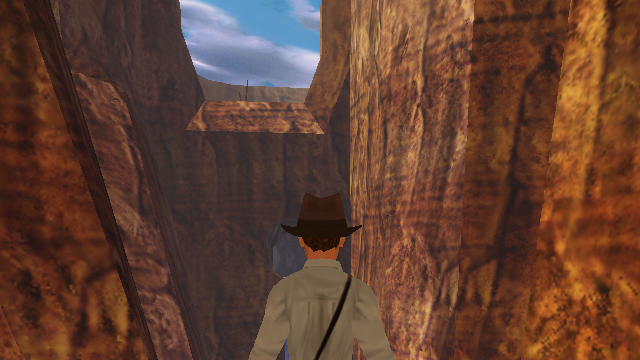 |
| [Colour grading](grading/README.md) | The Neutral, Warm, Cool, Adventure, Vivid and Muted presets. | 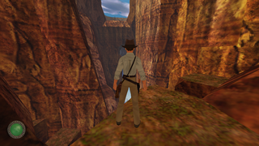 |
| [Depth of field](dof/README.md) | The cutscene and gameplay modes, Off and On, after the subtler retune. | 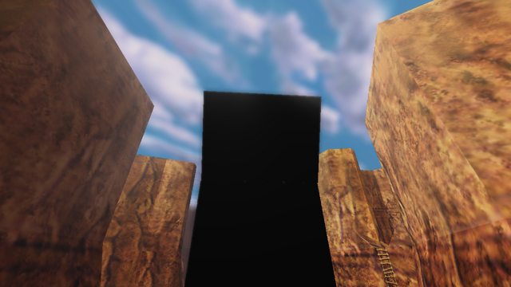 |
| [Light shafts](shafts/README.md) | The normal target's sky and water tags, and shafts Off, Low and High. | 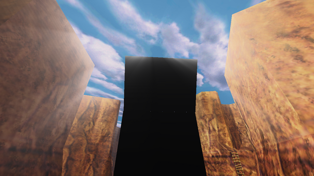 |
| [Water ripples](water/README.md) | The ripples Off, On, and On about a second later. | 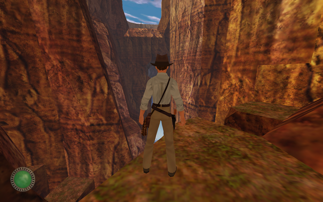 |
| [Ambient occlusion](ssao/README.md) | SSAO Off, Low and High in the gameplay and canyon views. | 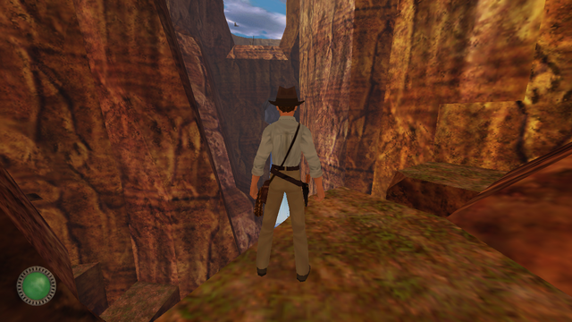 |
| [Camera effects](camera-fx/README.md) | Lens flare, vignette and film grain on the canyon and regress scenes. | 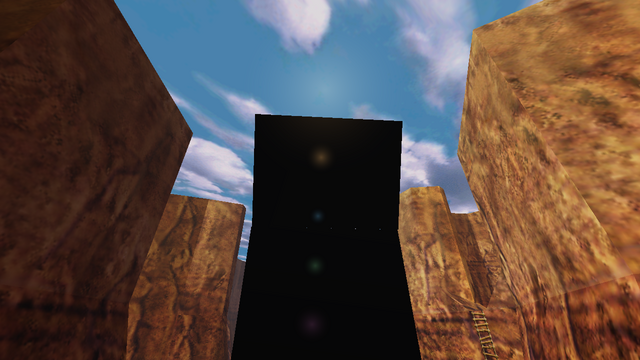 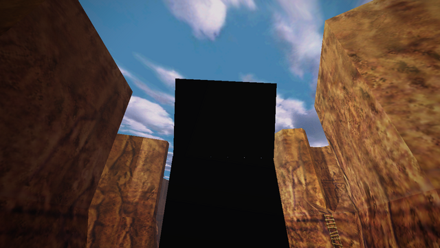 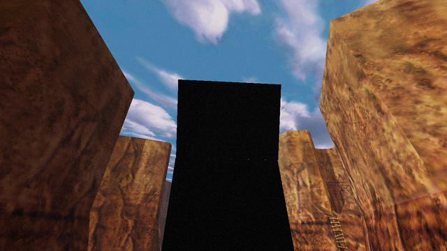 |

Motion blur has no screenshots: the windowed captures drift between runs under lavapipe, so its frames would
not isolate the effect from the scene's own motion. The fixed simulation tick has no screenshots by nature;
its evidence is the headless key proof, the identical traces and the log lines. The frame rate limit and
present modes also have no screenshot: they change pacing, not the image.
