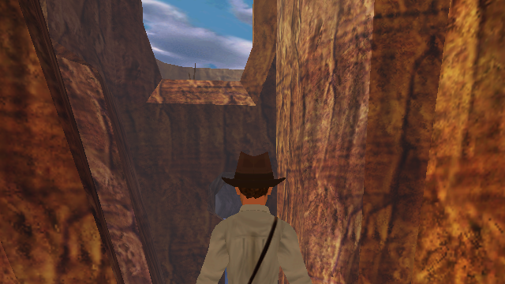
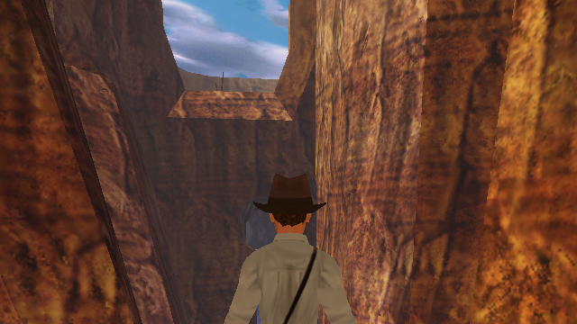

# M9.12: bloom

Frames from the windowed Babylon build of `m9.12-bloom` on Xvfb (1920x1080) with Mesa lavapipe, a 1280x720
window at +640+300, `regress.nds` from the GOG English data, about 55 s after start. Recorded 2026-11-21.
Anti-aliasing and sharpening are off, the tone map is Neutral at exposure 1.0 and the render scale is 100%;
only `engine.renderer.bloom` changes. Lavapipe renders on the CPU, so these show the picture, not performance.

The windowed run's log proves the stage runs:

```text
stdRenderBabylon: bloom on, strength 0.5; targets 640x360, 320x180, 160x90, 80x45, 40x23, composite 1280x720.
```

| Bloom | Full-frame mean luma | Sky crop mean luma |
| --- | --- | --- |
| Off (`engine.renderer.bloom` 0) | 0.231637 | 0.269345 |
| Low (`engine.renderer.bloom` 1, strength 0.15) | 0.232912 | 0.272423 |
| Medium (`engine.renderer.bloom` 2, strength 0.3) | 0.234188 | 0.275554 |
| High (`engine.renderer.bloom` 3, strength 0.5) | 0.235752 | 0.279279 |

The images are native 640x360 crops of the sky around the clouds at +320+0, so they are 640 wide without
resampling. The glow grows visibly from Off to Low to Medium; the lower half of the frame stays close to Off
(mean luma 0.209609 Off against 0.210502 High), so the canyon walls are not washed out.

| Bloom | Sky crop |
| --- | --- |
| Off |  |
| Low |  |
| Medium |  |
