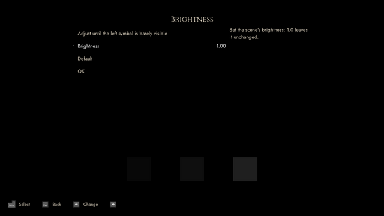

# M9.11: brightness calibration

The first windowed start of the Babylon build on Xvfb (1920x1080) with Mesa lavapipe and a
1280x720 window, from a user directory whose `Jones.cfg` has no `engine.renderer.brightness` key
and `startMode` 5 (main menu). The screen runs before the main menu; the frame is present 50 of the
`--screenshot-dir` capture, downscaled to 640 wide. The three test symbols use the final tone-map
pass's formula at scene values 0.03, 0.06 and 0.12, so at the default 1.0 they read 8, 15 and 31
in 8-bit sRGB. Recorded 2026-11-21.

