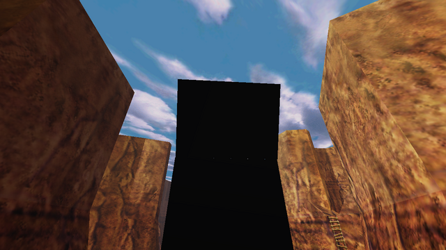
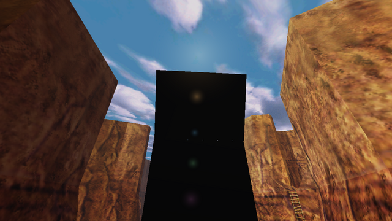
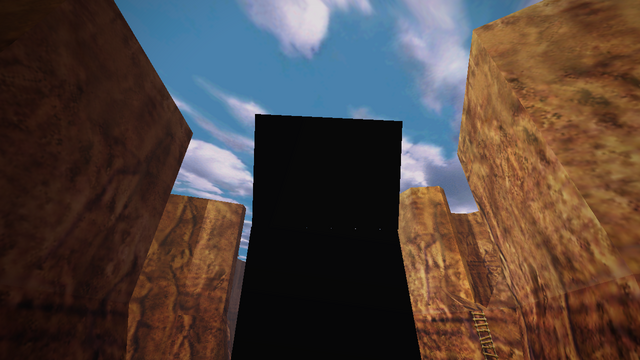
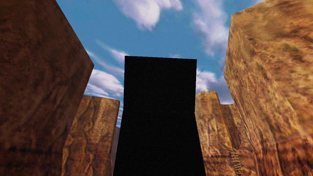
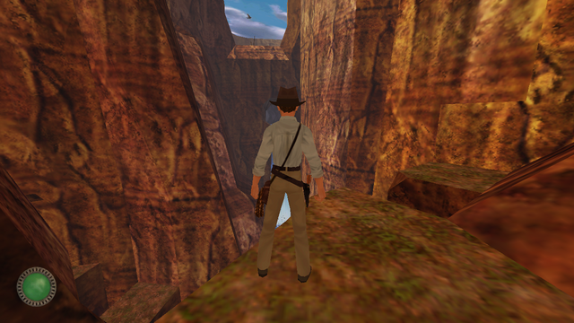
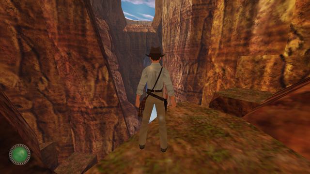
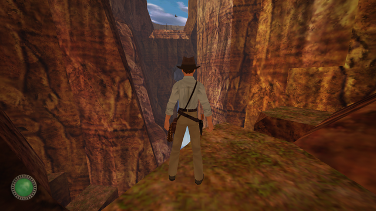

# M9.18: vignette, film grain and lens flare

Frames from the windowed Babylon build of `m9.18-camera-fx` on Xvfb (1920x1080) with Mesa lavapipe,
a 1280x720 window, the game data in `game/native/ref/run/Resource` and the `regress.nds` and
`start_01_CANYON.nds` saves. Anti-aliasing, sharpening, bloom, light shafts, depth of field, water
ripples and colour grading are off, the tone map is Neutral at exposure 1.0 and the render scale is
100%, so only `engine.renderer.lensFlare`, `.vignette` or `.filmGrain` changes between a row.
Recorded 2026-11-22. Lavapipe renders on the CPU, so these show the picture, not performance.

The canyon scene is present 2100 of `start_01_CANYON.nds`, the level-start canyon with the bright sky
around the dark obelisk. The regress scene is present 1200 of `regress.nds`, a stable in-game view
(the opening map animation and the first load occupy roughly the first 500 presents in this build).
The raw BMPs contain game data and are not committed; these are 640-wide downscales.

| Scene | Off | Lens flare | Vignette | Film grain |
| --- | --- | --- | --- | --- |
| Canyon |  |  |  |  |
| Regress |  |  |  |  |

Full-frame RMSE against Off at the 640-wide size:

| Scene | Lens flare | Vignette | Film grain |
| --- | --- | --- | --- |
| Canyon | 0.0477 | 0.0688 | 0.0603 |
| Regress | 0.0168 | 0.0349 | 0.0108 |

The vignette darkens the corners and leaves the centre unchanged in both scenes. The grain is
visible as fine luminance noise in the flat areas. The regress view has no sky, so its lens-flare run
adds nothing and the small difference is the frame-to-frame scene drift noted below.

Under lavapipe a run's wall-clock game time depends on how fast it presents, so the moving canyon
cutscene is at a slightly different camera phase in each run. The lens-flare canyon frame was taken
at present 450, where its phase is closest to the Off frame at 2100; the other effects were cheap
enough to keep the same phase as Off. The regress view is nearly static, so its pairs differ only by
the effect (its lens-flare pair has no sky, as expected). The deterministic GPU tests in
`std3DBabylonTest.cpp` prove each effect byte-for-byte; these frames show the look.
