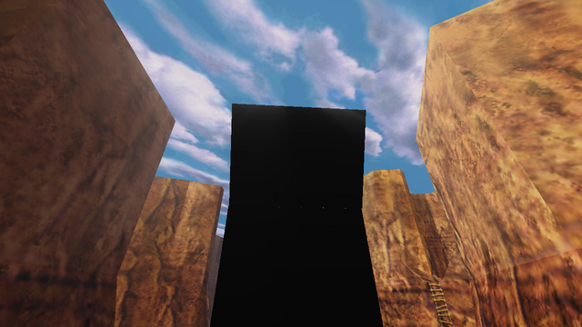
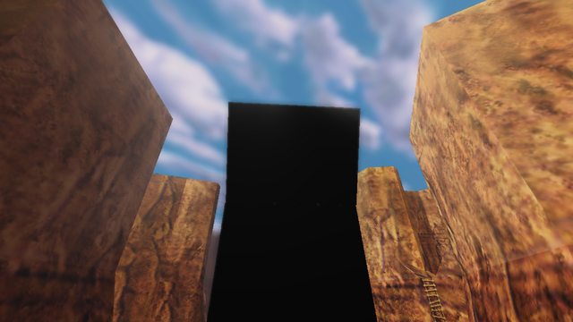
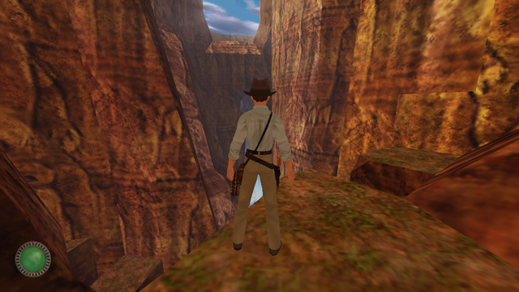
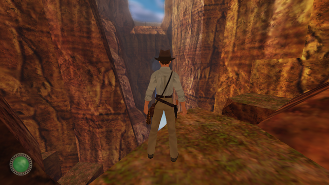

# M9.14: depth of field

Frames from the windowed Babylon build of `m9.14-dof` on Xvfb (1920x1080) with Mesa lavapipe, a
1280x720 window, the game data in `game/native/ref/run/Resource` and the `regress.nds` and
`start_01_CANYON.nds` saves. Anti-aliasing, sharpening, bloom and colour grading are off, the tone
map is Neutral at exposure 1.0 and the render scale is 100%, so only the two depth-of-field toggles
change between a pair. Recorded 2026-11-21; retaken 2026-11-22. Lavapipe renders on the CPU, so these show the picture,
not performance.

The gameplay pair is present 330 of `regress.nds`: the renderer logged a gameplay focus of
`0.210261`, and the gameplay ramp's absolute floor keeps the near corridor sharp while the far end
softens. The cutscene pair is present 800 of `start_01_CANYON.nds`, during the level-start cutscene
(the first presents are the load); the renderer logged a cutscene focus of `2.03665`. The raw BMPs
contain game data and are not committed; these are 640-wide downscales.

| Mode | Off (`engine.renderer.dof.*` false) | On (default in Enhanced) | Full-frame RMSE |
| --- | --- | --- | --- |
| Cutscene (`dof.cutscenes`) |  |  | 0.0450 |
| Gameplay (`dof.gameplay`) |  |  | 0.0072 |

The cutscene blurs both sides of the focus; the gameplay pair only softens the far background, so
the difference is smaller. The HUD, menus and prompts are composited after the stage and are
unchanged in both modes.

The windowed run's log proves the stage runs:

```text
stdRenderBabylon: depth of field on, cutscenes, strength 1, focus 2.03665.
stdRenderBabylon: depth of field on, gameplay, strength 1, focus 0.210261.
```

**Retuned 2026-11-21.** The first gameplay ramp started at `max(3 x focus, 6)` world units, but the gameplay focus
(camera to Indy) is about 0.21 units and most canyon geometry is nearer than 6, so only the sky (far plane 64)
blurred. It now starts at `max(4 x focus, 1)` and is full after another `max(12 x focus, 3)`. That retake ran on the merged M9 state with the Enhanced defaults (light shafts Low, bloom Low, SMAA, CAS) in both
frames, so only `dof.gameplay` differed; it is superseded by the 2026-11-22 pair above.

**Retuned 2026-11-22 (subtler).** Both blurs were too strong, so the gather radius at strength 1 is now 6 half-res texels (was 10). Gameplay keeps everything nearer than `max(6 x focus, 1.5)` sharp and ramps in over another `max(24 x focus, 6)` (was `max(4 x focus, 1)` over `max(12 x focus, 3)`). Cutscenes now have a dead zone of `max(0.25 x focus, 0.1)` and a span of `max(1.2 x focus, 1)` (was `max(0.1 x focus, 0.05)` and `max(0.6 x focus, 0.5)`). Both frames of each pair were retaken back to back with the same build and settings, toggling only the depth-of-field switches: gameplay at present 330 of `regress.nds` and the cutscene at present 800 of `start_01_CANYON.nds`. The presents were chosen so the two runs stay at the same scene phase in this sandbox; only the blur differs between a pair.
