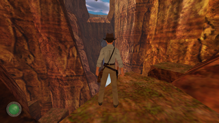

# M9.13: colour grading

Frames from the windowed Babylon build of `m9.13-color-grading` on Xvfb (1920x1080) with Mesa lavapipe, a
1280x720 window at +640+300, `regress.nds` from the GOG English data, screenshot present 2500. Recorded
2026-11-21. Anti-aliasing, sharpening and bloom are off, the tone map is Neutral at exposure 1.0 and the
render scale is 100%; only `engine.renderer.colorGrading` changes. Lavapipe renders on the CPU, so these
show the picture, not performance. The raw 1280x720 BMPs contain game data and stay local; these are
320-wide downscales.

The lookup is a 32^3 table generated in code and stored as a 1024 x 32 `Rgba8` strip of 32 slices side by
side. Warm and Cool shift the temperature slightly, Vivid and Muted scale saturation, and Adventure adds a
gentle S-curve with teal shadows and warm highlights. The effects are deliberately subtle, as colour
grading presets rather than per-level looks.

| Preset | `engine.renderer.colorGrading` | Image | Full-frame mean luma | Effect |
| --- | --- | --- | --- | --- |
| Neutral | 0 |  | 0.231585 | Identity; the lookup is skipped. |
| Warm | 1 |  | 0.234237 | Slight amber temperature shift and +3% saturation. |
| Cool | 2 |  | 0.228742 | Slight temperature shift towards blue. |
| Adventure | 3 |  | 0.228456 | Teal shadows, warm highlights and a gentle S-curve. |
| Vivid | 4 |  | 0.227798 | +12% saturation with a little more contrast. |
| Muted | 5 |  | 0.231538 | -20% saturation. |
