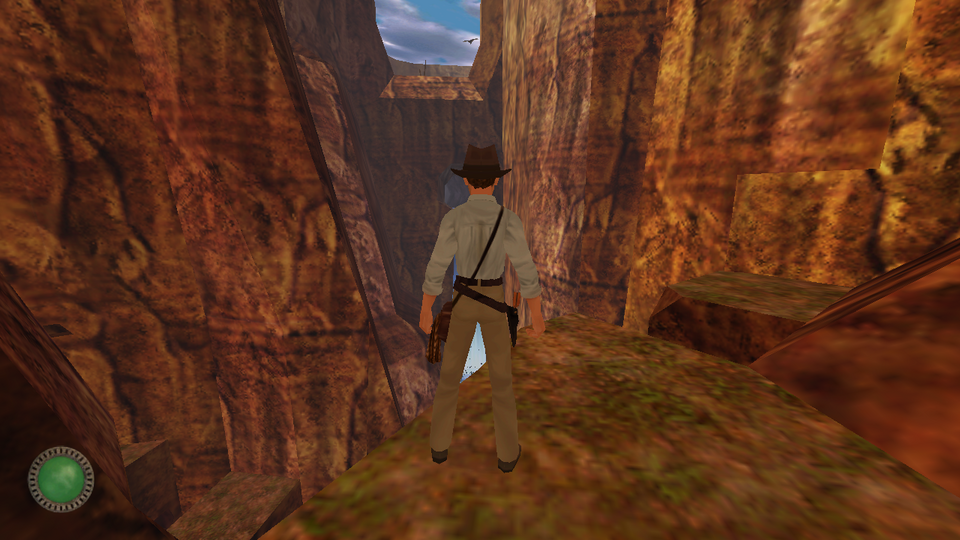
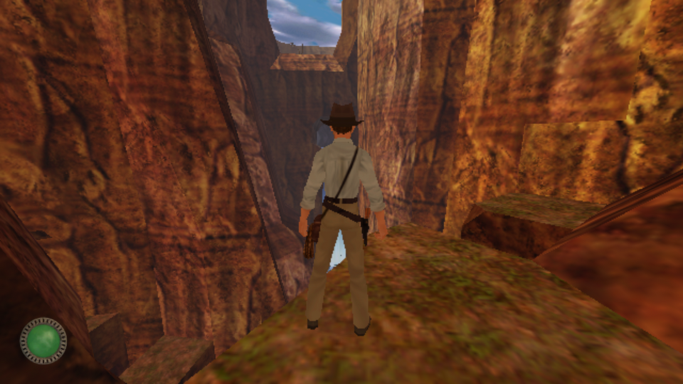
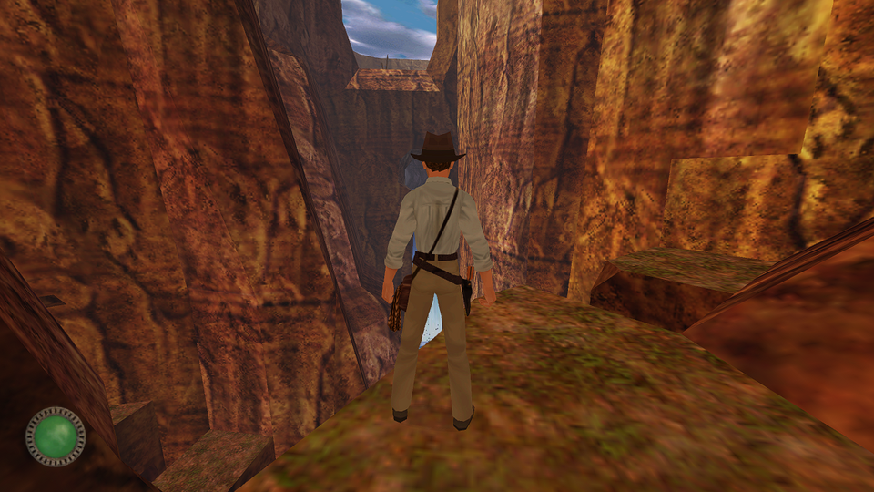
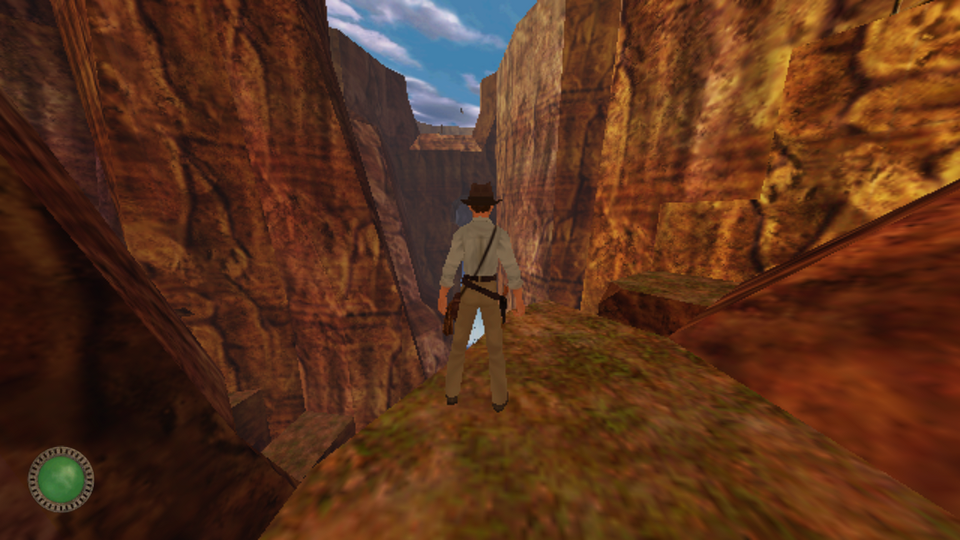
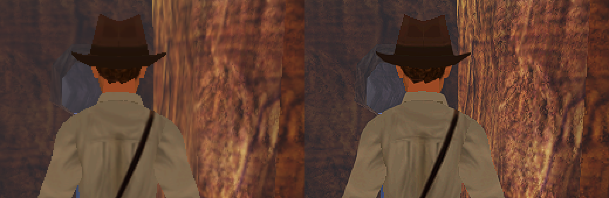
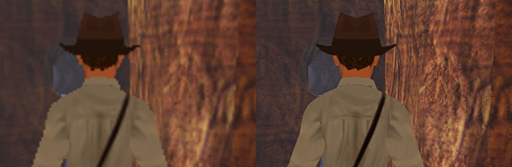

# M9 Phase 1: output and image quality (checkpoint B)

Frames from the windowed Babylon build of `m9-presentation` (abbbfe7f) on Xvfb with Mesa lavapipe, 1280x720,
`regress.nds` from the GOG English data, about 58 s after start. Recorded 2026-11-21. Downscaled to 960 px; the zoom
images are 3x crops (nearest neighbour) of the area around Indy's hat. Lavapipe renders on the CPU: these show the
picture, not performance; frame rate and pacing need a real GPU.

| Setting | Image | Notes |
| --- | --- | --- |
| Baseline: render scale 100%, AA off, sharpening off, anisotropic 1x |  | The picture before Phase 1's options (M9.3's HDR target is an identity at defaults). |
| Enhanced defaults: SMAA, sharpening 0.3, anisotropic 8x |  | Smoother silhouettes, crisper textures at a slant. |
| Render scale 50% (with the Enhanced defaults) |  | The 3D view at half resolution; the HUD (health ring, bottom left) stays sharp (M9.4b). |
| Render scale 200% |  | Supersampled 3D view. |
| Field of view 110 |  | Wider view; sighting and AI still use the default FOV (M9.6). |
| Crisp pixels, AA and sharpening off |  | Nearest texture filtering for the original blocky look. |

Zooms: baseline (left) vs. Enhanced defaults (right): 

Render scale 50% (left) vs. 200% (right): 
