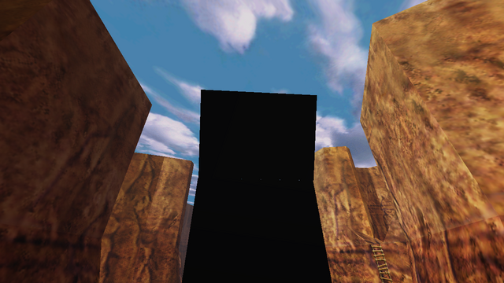
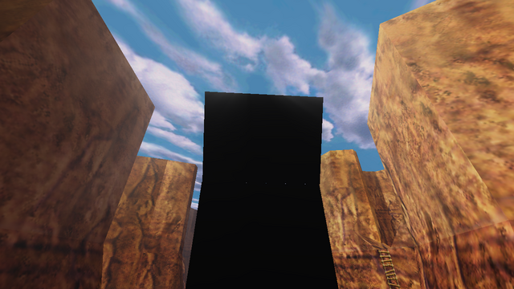
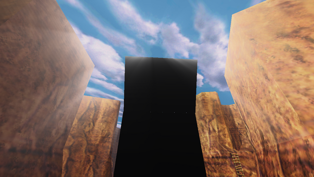
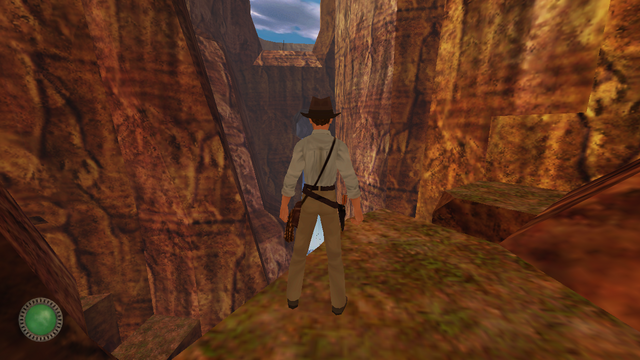
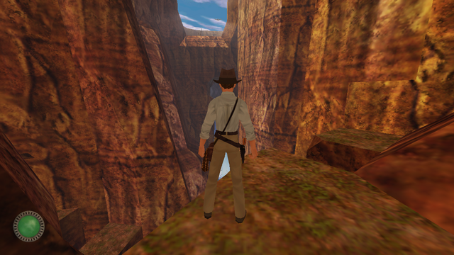
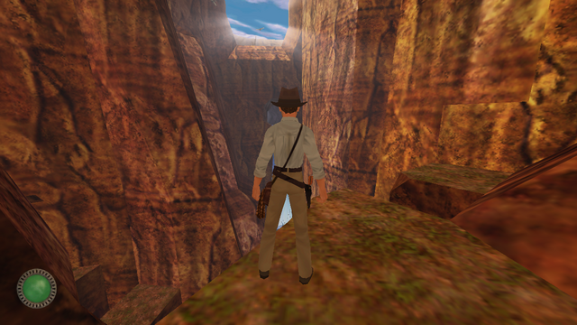

# M9.16: surface tags and light shafts

Frames from the windowed Babylon build of `m9.16-shafts` on Xvfb (1920x1080) with Mesa lavapipe, a
1280x720 window, the game data in `game/native/ref/run/Resource` and the `regress.nds` and
`start_01_CANYON.nds` saves. Anti-aliasing, sharpening, bloom, depth of field and colour grading are
off, the tone map is Neutral at exposure 1.0 and the render scale is 100%, so only
`engine.renderer.lightShafts` changes between a row. Recorded 2026-11-21. Lavapipe renders on the
CPU, so these show the picture, not performance.

The gameplay frames are present 2500 of `regress.nds`, looking up at the canyon gap with a small
bright sky patch. The canyon frames are present 2100 of `start_01_CANYON.nds`, during the level-start
cutscene, where the sky fills much of the frame around the dark obelisk. The raw BMPs contain game
data and are not committed; these are 640-wide downscales.

| Scene | Off (`engine.renderer.lightShafts` 0) | Low (1, strength 0.25) | High (3, strength 0.8) |
| --- | --- | --- | --- |
| Canyon cutscene |  |  |  |
| Regress gameplay |  |  |  |

Full-frame RMSE against Off at the 640-wide size:

| Scene | Low | High |
| --- | --- | --- |
| Canyon cutscene | 0.1004 | 0.1978 |
| Regress gameplay | 0.0210 | 0.0481 |

The canyon's large, bright sky produces clearly visible shafts through Low to High; the regress
frame's small sky patch gives a subtle glow at Low and visible rays at High. The composite scales the
shafts to 0.15 on sky-tagged pixels, so the clouds themselves stay crisp instead of being smeared
radially; the full addition falls on the geometry in front of the sky. The HUD, menus and prompts are
composited after the stage and are unchanged.

The windowed runs' logs prove the stage runs and the light position is found:

```text
stdRenderBabylon: light shafts on, level 1, strength 0.25; mask 640x360, 10 reduce levels, composite 1280x720.
stdRenderBabylon: light shafts on, level 3, strength 0.8; mask 640x360, 10 reduce levels, composite 1280x720.
```

During the canyon cutscene the GPU-side centroid settled at about `u = 0.45`, `v = 0.05` in image
uv, matching the bright sky at the top of the frame, with a mean mask weight around 0.0015.

## Method and constants

The normal target's alpha now tags each face: 1 ordinary, 2/3 sky and 1/3 water (both formats
represent those values exactly: 170/255 and 85/255 in `Rgba8`, two alpha bits in `R10G10B10A2`).
`sithRender` marks sky and water surfaces with `RD_FF_SKY_SURFACE` and `RD_FF_WATER_SURFACE`, and
`rdCache` turns them into the read-only `STD3D_RS_SURFACE_SKY`/`_WATER` state that the `std3D`
fragment shaders write as alpha. Things, sprites, particles and the HUD stay ordinary.

The shaft stage runs after depth of field and before bloom, at half the scene size:

- Mask: sky tag times `smoothstep(0.4, 0.6, luminance)`, written as `(w, w * u, w * v)`.
- Centroid: averaging four-tap downsample passes reduce the mask to 1 x 1, so the
  luminance-weighted position is available without a readback.
- Strength: `smoothstep(0.0002, 0.002, mean weight)` against the previous frame over 0.3 s of game
  time, so the shafts fade out when the sky leaves the view.
- Blur: 40 taps toward the centroid, 0.96 decay per tap, 0.95 of the way to the light.
- Composite: the blurred mask times 0.25, 0.5 or 0.8 (Low, Medium, High) is added to the HDR scene,
  scaled to 0.15 on pixels whose normal alpha still carries the sky tag and left at 1.0 elsewhere.

## Levels checked

Both saves used here load the same canyon world: 3210 surfaces, 123 with a horizon or ceiling sky
flag and 194 with `SITH_SURFACE_WATER`. `start_06_VOLCANO.nds` has 11903 surfaces, 92 sky surfaces
and 627 water surfaces. The two checked levels therefore both have sky surfaces; the canyon's water
count (194) is a useful first target for the M9.17 water work, and the volcano (627) a larger one.
