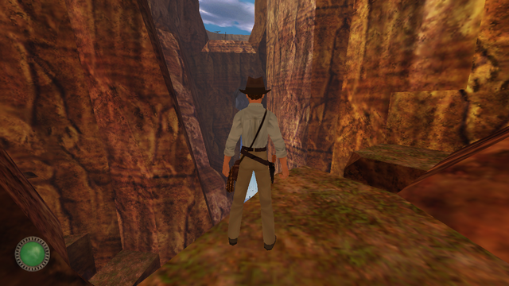
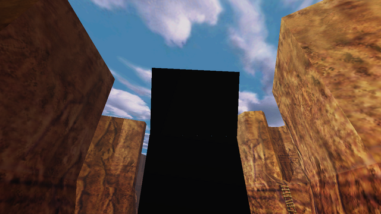
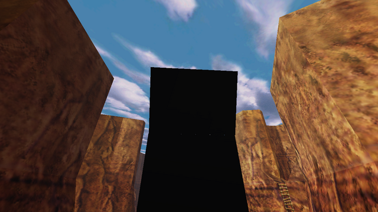

# M9.17b: screen-space ambient occlusion

Frames from the windowed Babylon build of `m9.17b-ssao` on Xvfb (1920x1080) with Mesa lavapipe, a
1280x720 window and the game data in `game/native/ref/run/Resource`. Anti-aliasing, sharpening,
bloom, light shafts, water ripples and depth of field are off, the tone map is Neutral at exposure
1.0 and the render scale is 100%, so only `engine.renderer.ssao` changes between the rows. Recorded
2026-11-22. Lavapipe renders on the CPU, so these show the picture, not performance.

The regress frames are present 1500 of `regress.nds`, after the level has loaded and while Indy
stands still. The canyon frames are `start_01_CANYON.nds` after its level-start cutscene: an input
script skips the cutscene with Escape at present 10 and the frame is captured at present 1500, once
the level has loaded. The raw BMPs contain game data and are not committed; these are 640-wide
downscales.

| Scene | Off (`engine.renderer.ssao` 0) | Low (1, 8 samples, r 0.25) | High (3, 16 samples, r 0.6) |
| --- | --- | --- | --- |
| Regress gameplay |  |  |  |
| Canyon after the cutscene |  |  |  |

Full-frame RMSE against Off at the 640-wide size:

| Scene | Low | High |
| --- | --- | --- |
| Regress gameplay | 0.0185 | 0.0312 |
| Canyon after the cutscene | 0.0735 | 0.0929 |

The regress pair is clean: two Low runs differ by only 0.0034 RMSE, so the difference is the stage.
The canyon's animated sky reaches a different phase in separate runs; two Low runs differ by about
0.0295 RMSE, mostly in the clouds at the top of the frame. The Off candidate with the closest sky
phase was chosen from three runs, but the canyon RMSE still includes some sky motion in addition to
the occlusion. On the geometry the stage darkens the crevices, the corners under the rock ledges
and the contact areas between rocks; the regress Off/High pair shows it clearly around the ledges
and the back wall. The sky and every pixel tagged water stay unchanged.

The windowed runs' logs prove the stage runs at the requested level:

```text
stdRenderBabylon: ambient occlusion on, level 1, 8 samples, radius 0.25; targets 640x360, composite 1280x720.
stdRenderBabylon: ambient occlusion on, level 3, 16 samples, radius 0.6; targets 640x360, composite 1280x720.
```

## Method and constants

The stage runs after the water ripples and before depth of field. The scene depth target is sampled
(the depth format is also `Sampled` where the device allows it). It holds rdCamera's `sz`: 0.1 at
the near plane and 1.0 at the far plane, 1/z-linear in between, because the first-person overlay
uses 0..0.1; the stage leaves overlay pixels alone. The view-space position is reconstructed from
the linearised depth. `std3D_SetProjection` hands `stdRenderBabylon_SetProjection` the horizontal
fov at the 4:3 reference aspect and the planes; the vertical tangent is derived from that fov and
the horizontal tangent from the real aspect, so the reconstruction is aspect-correct (Hor+) at
16:9 and wider.

The classic draws write a constant facing-the-camera normal, so the normal comes from the
neighbouring depths: the difference to the left or right and to the upper or lower neighbour with
the smaller depth difference is used on each axis, and their cross product gives the normal. That
keeps a depth edge from tilting it.

The occlusion pass runs at half the scene size:

- Kernel: 8, 12 or 16 samples of a normal-oriented hemisphere, a fixed golden-angle spiral with no
  time-based noise.
- Rotation: a fixed 4 x 4 interleaved pattern, the angle indexed by the half-res pixel.
- Radius and bias: world-space values per level; a range check `(radius / |centerZ - sceneZ|)^2`
  keeps distant occluders from darkening.
- Levels: Low `{8, radius 0.25, bias 0.015, intensity 0.65}`, Medium
  `{12, 0.40, 0.020, 0.80}`, High `{16, 0.60, 0.025, 1.00}`.
- Composite: a 4 x 4 depth-aware bilateral blur removes the rotation pattern, then a scene-sized
  pass multiplies the HDR scene colour by `1 - intensity * occlusion / samples`.

Pixels whose normal-target alpha is 0 (nothing drawn), `1/3` (water) or `2/3` (sky) are returned
unchanged by the composite, so the stage never darkens the sky, translucent water, the HUD, 2D
layer, menus or prompts. Off skips every pass, so the image is byte-identical to the path without
the option.
