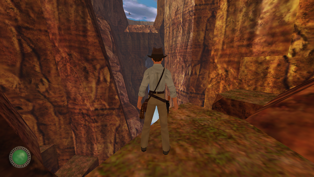
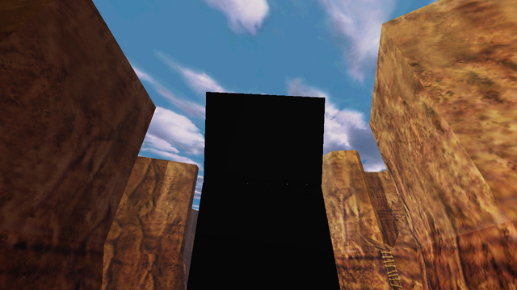
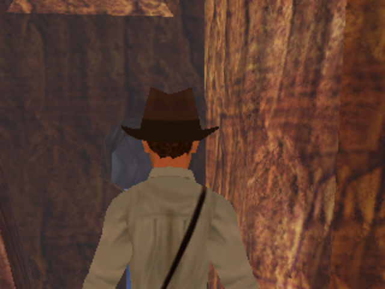

# M9.17b: screen-space ambient occlusion

Frames from the windowed Babylon build of `m9-phase4` with the SSAO world-scale fix (`fix-ssao-scale`)
on Xvfb (1920x1080) with Mesa lavapipe, a 1280x720 window and the game data in
`game/native/ref/run/Resource`. Anti-aliasing, sharpening, bloom, light shafts, lens flare, vignette,
film grain, motion blur, water ripples and depth of field are off, the tone map is Neutral at exposure
1.0 and the render scale is 100%, so only `engine.renderer.ssao` changes between the rows. Recorded
2026-11-22. Lavapipe renders on the CPU, so these show the picture, not performance.

The regress frames are present 1500 of `regress.nds`, after the level has loaded and while Indy
stands still. The canyon frames are `start_01_CANYON.nds` after its level-start cutscene: an input
script skips the cutscene with Escape at present 10 and the frame is captured at present 1500. The
raw BMPs contain game data and are not committed; these are 640-wide downscales.

| Scene | Off (`engine.renderer.ssao` 0) | Low (1, 8 samples, r 0.020) | High (3, 16 samples, r 0.050) |
| --- | --- | --- | --- |
| Regress gameplay |  |  |  |
| Canyon after the cutscene |  |  |  |

Full-frame RMSE against Off at the 640-wide size:

| Scene | Low | High |
| --- | --- | --- |
| Regress gameplay | 0.0134 | 0.0141 |
| Canyon after the cutscene | 0.0614 | 0.0520 |

The regress scene is deterministic apart from Indy's idle pose and a small animated sky sliver: two
Off runs differ by only 0.14 levels RMS outside those. Over the same area the Low and High frames
differ from Off by 2.31 and 2.44 levels RMS, on the rock crevices and the ground contact. The
canyon's animated sky and lighting reach a different phase in separate runs; two Off runs differ by
0.0087 RMSE on the lower 40% of the frame, about as much as the stage does, so the canyon row shows
the picture rather than isolating the occlusion. The Off candidate with the closest sky phase to the
Low and High runs was chosen from three runs.

## The scale fix

The game world is small: Indy's model radius is 0.092 world units (about 0.2 units tall) and his
collision height is 0.08, while the gameplay camera sits about 0.21 units behind him (the depth-of-
field log prints a focus of `0.210261`). The first SSAO table was tuned on a metre-scale scene, so
its 0.25..0.6-unit radii darkened several of Indy's own heights of the wall and ground behind him,
which read as a dark block pushed in front of him on High. The radii are now on the game's scale and
the range check fades an occluder out by twice the radius, so a surface much nearer than the shaded
one (Indy against the wall) contributes nothing.

The crop below is the same 320 x 240 region around Indy's head and shoulders, scaled to 640 wide.
Before the fix (not committed; measured on the unfixed build) the mean darkening in a 40-pixel ring
around his silhouette was 5.18% on High; after the fix it is 0.56%. The Low ring went from 1.21% to
0.67%. The small remaining value is the real contact shadow on the ground at his feet, not a halo.

| Regress, Indy crop, Off | Regress, Indy crop, High |
| --- | --- |
|  |  |

The windowed runs' logs prove the stage runs at the requested level:

```text
stdRenderBabylon: ambient occlusion on, level 1, 8 samples, radius 0.02; targets 640x360, composite 1280x720.
stdRenderBabylon: ambient occlusion on, level 3, 16 samples, radius 0.05; targets 640x360, composite 1280x720.
```

## Method and constants

The stage runs after the water ripples and before depth of field. The scene depth target is sampled
(the depth format is also `Sampled` where the device allows it). It holds rdCamera's `sz`: 0.1 at
the near plane and 1.0 at the far plane, 1/z-linear in between, because the first-person overlay
uses 0..0.1; the stage leaves overlay pixels alone. The view-space position is reconstructed from
the linearised depth. `std3D_SetProjection` hands `stdRenderBabylon_SetProjection` the horizontal
fov at the 4:3 reference aspect and the planes; the vertical tangent is derived from that fov and
the horizontal tangent from the real aspect, so the reconstruction is aspect-correct (Hor+) at
16:9 and wider.

The classic draws write a constant facing-the-camera normal, so the normal comes from the
neighbouring depths: the difference to the left or right and to the upper or lower neighbour with
the smaller depth difference is used on each axis, and their cross product gives the normal. That
keeps a depth edge from tilting it.

The occlusion pass runs at half the scene size:

- Kernel: 8, 12 or 16 samples of a normal-oriented hemisphere, a fixed golden-angle spiral with no
  time-based noise.
- Rotation: a fixed 4 x 4 interleaved pattern, the angle indexed by the half-res pixel.
- Radius and bias: world-space values per level; the range weight is
  `saturate(1 - |centerZ - sceneZ| / (2 * radius))`, squared, so an occluder more than twice the
  radius nearer than the shaded point contributes nothing.
- Levels: Low `{8, radius 0.020, bias 0.0012, intensity 0.65}`, Medium
  `{12, 0.035, 0.0018, 0.80}`, High `{16, 0.050, 0.0025, 1.00}`.
- Composite: a 4 x 4 depth-aware bilateral blur removes the rotation pattern, then a scene-sized
  pass multiplies the HDR scene colour by `1 - intensity * occlusion / samples`. The blur's depth
  weight is `1 / (radius * 4)`, so it follows the new radius and does not bleed across Indy's
  silhouette.

Pixels whose normal-target alpha is 0 (nothing drawn), `1/3` (water) or `2/3` (sky) are returned
unchanged by the composite, so the stage never darkens the sky, translucent water, the HUD, 2D
layer, menus or prompts. Off skips every pass, so the image is byte-identical to the path without
the option.
