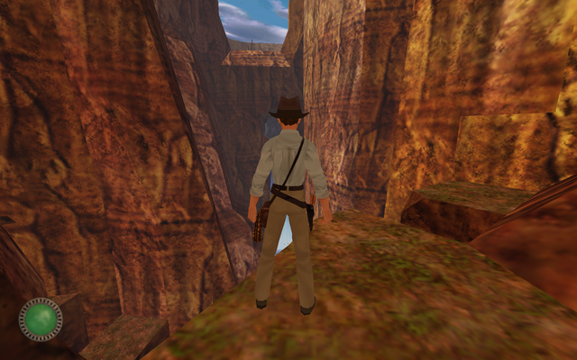
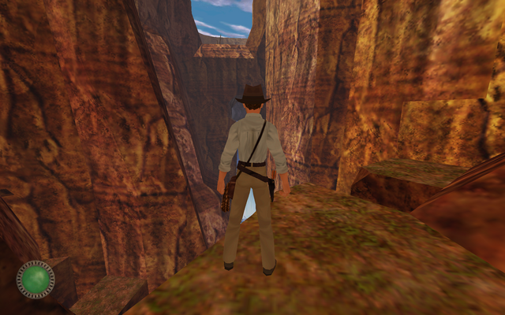
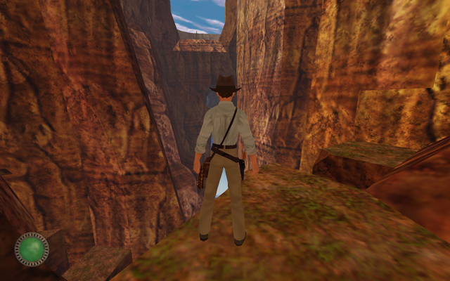

# M9.17 water ripples

`engine.renderer.water.ripples` off and on, regress save, windowed build on Xvfb (lavapipe), 640 wide.

| Off | On | On, about 1 s later |
| --- | --- | --- |
|  |  |  |

Only the thin strip of river below Indy is water in this view, so the difference is small at this size. A view
where water fills the frame is still to be captured. Screen-space reflections are not built: translucent water does
not write depth (see Docs/Jones.cfg.md).
