# M9.5 widescreen check

These frames check the presentation at 4:3 (1024x768), 16:9 (1280x720) and 21:9 (1680x720). They
come from the windowed Babylon build of `m9.5-widescreen` run on Xvfb with Mesa lavapipe, the game
data in `game/native/ref/run/Resource`, and the `regress.nds` and `start_01_CANYON.nds` saves. The
gameplay frames are after the regress scene has loaded (screenshot present 2500), the cutscene frames
are from the canyon level start (present 1200), and the movie frames are from the intro's LucasArts
logo (present 120). Recorded 2026-11-21. The raw BMPs and render captures contain game data and are
not committed; these are 640-wide downscales.

| Scene | Aspect | Before | After | What changed |
| --- | --- | --- | --- | --- |
| Gameplay HUD | 4:3 | 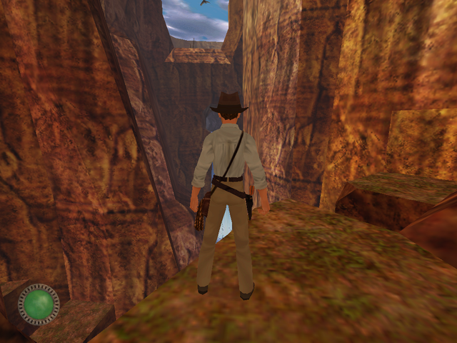 |  | None: the 4:3 layout is unchanged. |
| Gameplay HUD | 16:9 |  | 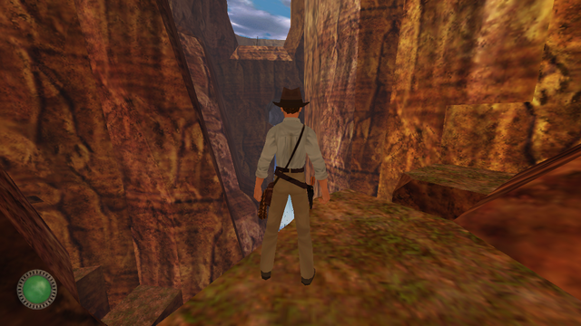 | None: the 16:9 edge anchor is already outside the whole safe area. |
| Gameplay HUD | 21:9 | 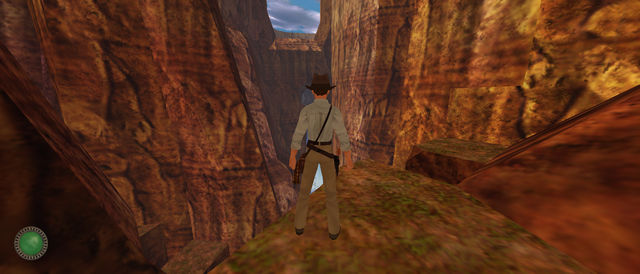 | 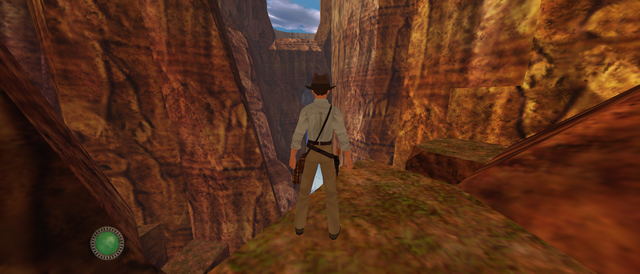 | Health and endurance now sit at the edges of the centered 16:9 safe area instead of the far corners. |
| Cutscene framing | 4:3 |  | 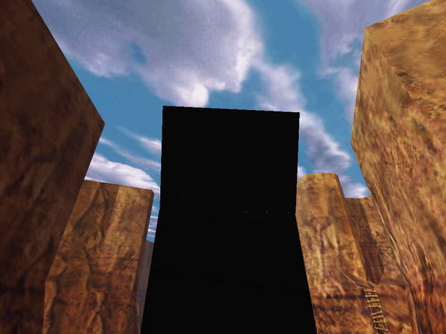 | None; the cutscene camera was already hor+ and is not touched. |
| Cutscene framing | 16:9 | 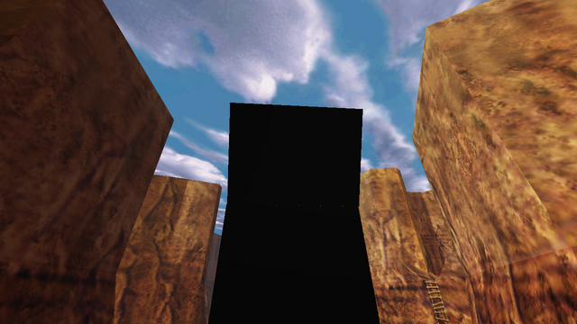 |  | None; the 4:3 content stays fully visible with extra scene at the sides. |
| Cutscene framing | 21:9 |  | 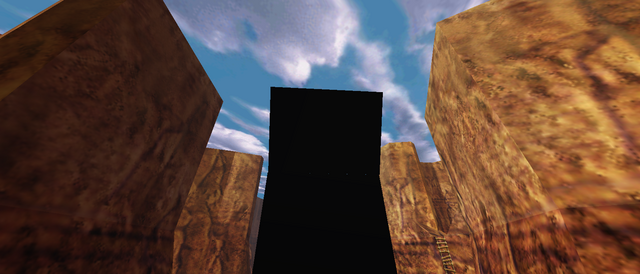 | None; more canyon is visible at the sides, with the vertical framing unchanged. |
| Intro movie | 4:3 | 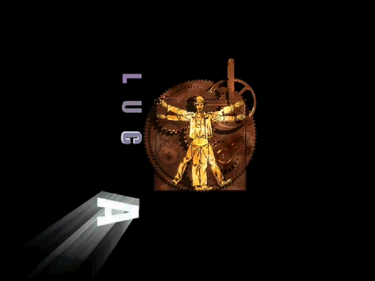 |  | None; a 4:3 movie still fills a 4:3 canvas. |
| Intro movie | 16:9 |  | 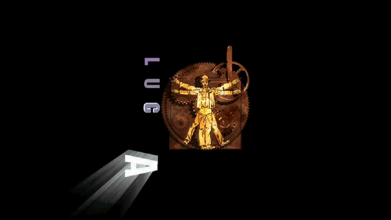 | The 4:3 movie is pillarboxed instead of stretched to the 16:9 canvas. |
| Intro movie | 21:9 |  | 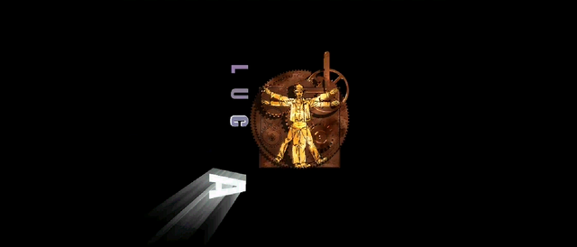 | The 4:3 movie is pillarboxed to 57% of the canvas width instead of stretched to all of it. |

The cutscene images for "before" and "after" are the same frame: the fix does not change the camera,
and the windowed captures at a fixed present number fall at slightly different cutscene times. The
movie mostly plays on black, so the black pillars blend into the frame; the logo beam and the bright
edges show the difference in content width (384 px to 293 px at 16:9, and 389 px to 223 px at 21:9 in
these 640-wide downscales).

The centered inventory menu (item icons, the compass and the ammo displays) also stays centered
inside the 16:9 safe area at 21:9, so it needed no change:

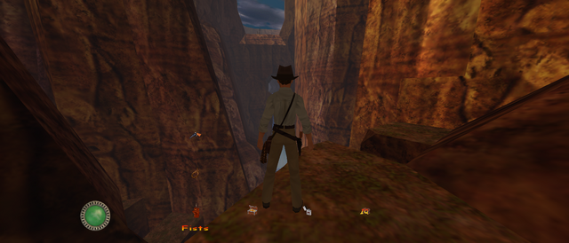
