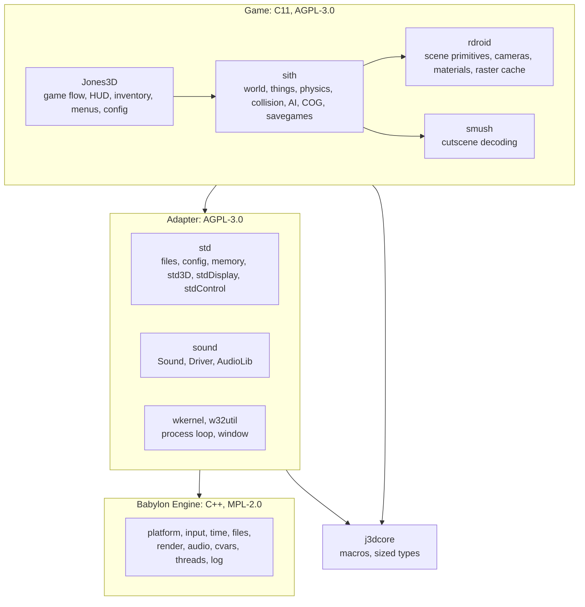

# 5. Building block view

## 5.1 Level 1: the whole system

| Building block | Responsibility | Interface | Where |
|---|---|---|---|
| Jones3D | Application: startup, menus, HUD, inventory, level flow, configuration | Called by the host loop | `Jones3D/` |
| sith | Gameplay runtime: worlds, things, physics, collision, AI, COG VM, cameras, savegames | `sith*` functions | `Libs/sith/` |
| rdroid | Renderer-facing primitives: cameras, materials, models, keyframes, the raster cache | `rd*` functions | `Libs/rdroid/` |
| smush | Cutscene (SMUSH/SAN) decoding | `smush*` functions | `Libs/smush/` |
| Adapter | The recovered platform functions the game calls, mapped onto Babylon | `std*`, `Sound_*`, `Driver_*`, `wkernel_*` | `Libs/std/`, `Libs/sound/`, `Libs/wkernel/`, `Libs/w32util/` |
| Babylon Engine | Game-agnostic platform framework: one interface per role, several backends | C++ interfaces in `Babylon/` | `Babylon/` (from M5) |
| j3dcore | Lowest support layer: macros and sized types shared by game and adapter | `j3d.h` | `Libs/j3dcore/` |

Dependencies only point down. Babylon depends on nothing above it, and nothing in Babylon names a Jones3D
or Sith concept ([ADR-0006](../09-decisions/ADR-0006-babylon-engine-in-repo.md),
[ADR-0007](../09-decisions/ADR-0007-adapter-between-game-and-babylon.md)).

**Today (M6.10):** two platform columns exist, chosen at configure time. The **Null column** is the M4 backend
described in [Platform-Layer.md](Platform-Layer.md). The **Babylon column**
(`-DJONES3D_PLATFORM_BABYLON=ON`; the default and only choice on Windows, which builds it as a 64-bit program)
is the Null column with time, files, input, the window and rendering moved onto Babylon; sound still uses the
Null backend until M7. The Win32 and DirectX columns were removed in M6.3. All columns produce identical
headless traces, byte for byte.

## 5.2 Level 2: Babylon Engine

Modules marked M5 exist and are used by the Babylon column. Render exists from M6.4 and the game uses it since
M6.6 (`std3D`) and M6.7 (`stdDisplay`). Audio has its interface and Null backend from M7.1 and joins the game
with the miniaudio backend in M7.2; the others are still planned.

| Module | Role | Backends | Adapter that uses it | State |
|---|---|---|---|---|
| core | Shared types, version, locale-free number parsing | | | M5 |
| Log | Leveled logging with sinks | | | M5 (the game still logs through `STDLOG_*`) |
| Platform | Windows and the one event queue (window, key, mouse and gamepad events) | SDL3, Null | `wkernelBabylon.cpp`, `stdBabylonEvents.cpp` | M5 |
| Input | Input state built from platform events; input scripts (ADR-0018) | none of its own: events come from Platform or a script | `stdControlDevicesBabylon.cpp` | M5 (keys and mouse buttons; mouse axes and gamepads later) |
| Time | Monotonic clock and a caller-driven Null clock | SDL3, Null | `stdPlatformTimeBabylon.cpp` | M5 |
| Files | Files, directory listing, base, current and user directories | SDL3, Null | `stdFileBabylon.cpp`, `stdFileUtilBabylon.cpp`, `stdBabylonPath.cpp` | M5 |
| Cvars | Named, typed settings with flags, ranges and change callbacks (ADR-0020) | | `stdCvarBabylon.cpp` (`game.profile`) | M5 |
| Render | Devices, textures, buffers, shaders, draw submission | SDL3 GPU, Null | `std3D` (from M6.6), `stdDisplay` (from M6.7) | M6.4 (interface and both backends; game use in M6.6 and M6.7) |
| Audio | Devices, voices, 3D positioning, streaming | Null, miniaudio | `Driver_*` in M7.2 | M7.1: interface and Null backend; M7.2: miniaudio backend (low-level `ma_device` with own mixer, null-device mode for tests) |
| UI | Widgets, layout, screen stack, focus, keyboard/mouse/gamepad navigation, cvar binding (ADR-0026) | Null painter; draws through Render from M7.9 | `jonesConfig_*` screens | M7.8 (interface, layout and Null painter; render painter in M7.9) |
| Threads | Threads, jobs, synchronization | SDL3 | | M11 and later |

The adapter files live in `Libs/std/Babylon/` and `Libs/wkernel/`; they reach Babylon through one context
pointer (`Libs/std/Babylon/stdBabylon.h`) that the composition root fills
(`Jones3D/Platform/Babylon/main.cpp` for `Jones3D-headless`, `mainWindowed.cpp` for the windowed `Jones3D`).

Each module is its own CMake target with a public `include/` and a private `src/`, and may only use the
modules it declares ([ADR-0015](../09-decisions/ADR-0015-babylon-modules-as-cmake-targets.md)).

Every module has a Null backend that honors the interface's contract without a device. Null backends let
the whole game run headless, which is how traces are recorded ([chapter 8](../08-crosscutting/README.md)).

### The render module (M6.4)

`Babylon/render/` is the Babylon replacement for the DirectX 9 `std3D` and `stdDisplay` backends
([ADR-0025](../09-decisions/ADR-0025-babylon-render-interface.md)). It depends on `log`, on `platform` (the SDL GPU
backend's window) and on SDL3. `std3D` draws on it since M6.6 and `stdDisplay` presents the 2D layer on it since
M6.7 (see [Rendering-And-Visibility.md](Rendering-And-Visibility.md)). Shaders are compiled at build time with
SDL_shadercross ([ADR-0022](../09-decisions/ADR-0022-shaders-compiled-at-build-time.md)), and pipelines and draws
run on both backends.

**Device and handles.** One interface, `babylon::render::Device`, owns every texture, buffer, sampler and
pipeline and executes frames. Callers see descs in game-agnostic terms (`TextureDesc` with mips, a byte
layout fixed in `Texture.h`, and `Sampled`, `ColorTarget` or `DepthTarget` usage; `BufferDesc` with
`Vertex`, `Index` or `Storage` usage; `SamplerDesc`; `PipelineDesc` with vertex layout, primitive, blend
per color target, depth and cull) and typed handles, never a backend object. A handle is a slot index plus
that slot's generation; destroying the resource bumps the generation, so the device detects a stale handle
instead of touching a reused slot. Every failure logs exactly one `babylon::log::warning` line and changes
nothing; nothing throws, and a failed create returns the null handle.

**CommandList.** A frame is recorded on the CPU into a concrete `CommandList`, the same class on every
backend. It records render passes with load and store operations and clear values (the null texture handle
names the swapchain), pipeline and resource bindings (vertex, index and read-only storage buffers,
textures), uniform pushes, draws, texture copies and buffer updates. Recording makes no virtual call: the list checks the frame's structure (render commands only
inside a pass, copies and updates only outside, a pipeline before a draw, slots in range) and refuses a
misuse with one warning. Everything that needs the device's live resources is left to `Device::submit()`.
A draw of zero vertices or indices is no error and records nothing. `CommandList::updateBuffer()` copies
the bytes into the list and writes them at their place, so several draws of one frame can stream through
one buffer.

**Submit-time checks.** `Device::submit()` is the shared, non-virtual entry point. It first refuses a list
that belongs to another device or frame, one already submitted, or one with a pass still open. It then
checks every command against the live resources: stale or null handles, missing texture or buffer usage, a
pipeline whose target formats differ from the pass's, a vertex or index buffer bound past its end, vertex
or index ranges past the buffer, copies between different formats or out of bounds, and buffer updates
past the end. A draw is also dropped when its shaders declare a texture, uniform or storage buffer slot
that no earlier `bindTexture`, `pushUniforms` or `bindStorageBuffer` in the same pass filled (the exact
rule is in `Device.h`). A rejected
command is dropped with one warning; a dropped `beginPass` drops its whole pass,
and after another dropped command the pass's later draws are dropped silently. The accepted commands run in
order, and `submit()` presents when a pass drew to the swapchain of a device that has one.

**Null backend.** `createNullDevice()` touches no GPU and is for tests and headless runs. It honors the
whole `Device` contract: it keeps texture and buffer contents in memory, applies uploads, clears of texture
targets, copies and buffer updates, and returns real bytes from `readTexture()` and `readBuffer()`. It does
not rasterize, so draws change no contents. It is headless (no swapchain), accepts shader blobs in every
format without looking at the code, reports maxTextureDimension 8192 and maxBufferSize 256 MiB, and
zero-fills new resources. It records every pipeline creation and every executed command of a submitted
list, followed by one `FrameSubmitted`, so tests can compare a whole frame.

**SDL GPU backend.** `createSdlGpuDevice(platform::Window*)` uses SDL3 GPU (Vulkan, Direct3D 12 or Metal,
whichever SDL finds) and takes shaders in the formats the driver reports. A null window makes a headless
device; with a window from the SDL platform backend it claims the window for its swapchain (the window must
outlive the device) and presents the image when a pass drew to it. It initializes SDL's video subsystem, so
without a display `SDL_VIDEO_DRIVER=offscreen` supplies a headless one. B4G4R4A4 can only be sampled here,
never a color target: Vulkan stores it with the components in other bits and SDL fixes that up only when
sampling, so uploads, copies and readback keep the layout of `Texture.h`, but clears and draws would write
the wrong bits. SDL GPU has no limit queries, so the backend reports fixed limits of 8192 texels and 128 MiB
per buffer. Uploads and readbacks run in their own command buffers, ordered with submits; a readback waits
for the GPU. Pipelines and draws are tested: `ShaderDrawTest.cpp` draws a triangle, a textured quad and
depth-tested quads through the compiled shaders and compares the read-back image. The contract tests cover
device info, texture and buffer creation and contents, clears, copies, buffer updates and the swapchain.

The render contract tests live in `Babylon/render/tests/` and run against both backends
([Testing.md](../../Testing.md)).

## 5.3 Level 2: game subsystems

These pages describe the game's subsystems as they are today:

| Page | Covers |
|---|---|
| [Quick-Reference.md](Quick-Reference.md) | A short mental model of the whole engine: layers, worlds and things, sectors and adjoins |
| [World-And-Resources.md](World-And-Resources.md) | `SithWorld`, world loading, section parsing, resource ownership |
| [Collision-System.md](Collision-System.md) | Movement tracing, hit collection, handler dispatch, line of sight, collision response |
| [Control-And-Input.md](Control-And-Input.md) | Raw input backends, logical bindings, idle detection, control intent |
| [Camera-System.md](Camera-System.md) | System cameras, interpolation, camera collision, cutscene cameras |
| [Rendering-And-Visibility.md](Rendering-And-Visibility.md) | Camera stack, sector visibility, PVS, thing and light collection, dynamic lighting |
| [Scripting-AI-And-Audio.md](Scripting-AI-And-Audio.md) | COG VM, AI control blocks and awareness, the audio stack |
| [Sound-System.md](Sound-System.md) | Sound engine, gameplay mixer, sound classes, voice playback |
| [In-Game-Menus.md](In-Game-Menus.md) | The M7 menus and screens that replace the Win32 dialogs |
| [Platform-Layer.md](Platform-Layer.md) | The M3 and M4 platform layer that Babylon replaces |

Tests live beside the code they cover, in `Tests/` directories. See [Testing.md](../../Testing.md).
