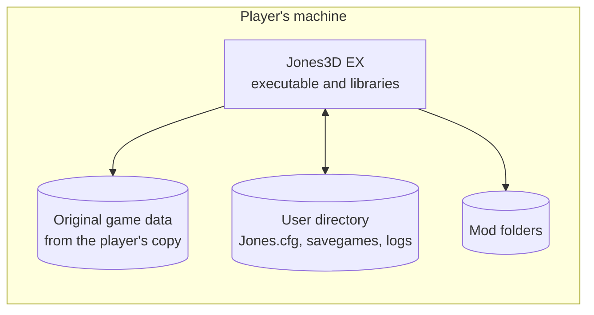

# 7. Deployment view

## 7.1 Builds

| Build | Platform | Status | Product |
|---|---|---|---|
| Headless Null | Null platform, non-Windows, 32-bit or 64-bit | Works | `Jones3D-headless` |
| Headless Babylon | Babylon files, clock and input; Linux, macOS, 64-bit Windows | Works; the 64-bit Windows program runs under wine in development | `Jones3D-headless` (`Jones3D-headless.exe` on Windows) |
| Windowed Babylon | Babylon on SDL3 and SDL3 GPU, x86-64; Linux, macOS, 64-bit Windows | Opens a window; the Null renderer draws nothing until M6.6 | `Jones3D` (`Jones3D.exe` on Windows) |

The Win32 and DirectX 6/9 builds were removed in M6.3 ([ADR-0011](09-decisions/ADR-0011-retire-win32-directx.md));
32-bit Windows is a configure error. CI builds and tests every Babylon build on its own operating system from
M5 on.

## 7.2 What a player installs

| Part | Comes from | Where |
|---|---|---|
| Executable and its libraries (SDL3, miniaudio is compiled in) | Jones3D EX release package | Anywhere |
| Original game data | The player's copy of the game (Steam, GOG or CD), never the release package | A directory the player points to, or found automatically |
| Settings, savegames, logs | Written by Jones3D EX | Planned: the operating system's user data directory. Today: the game directory |
| Mods | The player | Planned: a mods directory beside the user data |

The details, including how game data is found and installed, are settled in M8.
