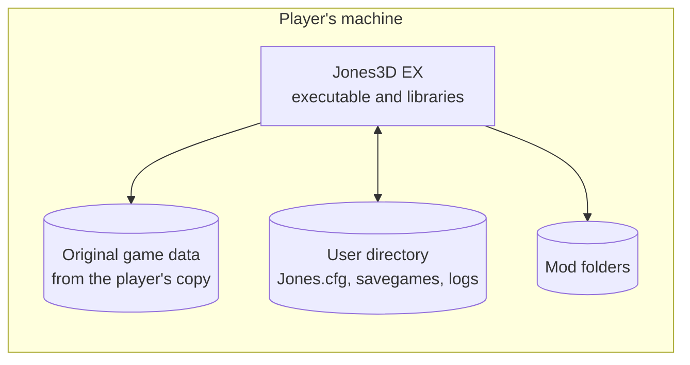

# 7. Deployment view

## 7.1 Builds

| Build | Platform | Status | Product |
|---|---|---|---|
| Headless Null | Null platform, non-Windows, 32-bit or 64-bit | Works | `Jones3D-headless` |
| Headless Babylon | Babylon files, clock and input; Linux, macOS, 64-bit Windows | Works; the 64-bit Windows program runs under wine in development | `Jones3D-headless` (`Jones3D-headless.exe` on Windows) |
| Windowed Babylon | Babylon on SDL3 and SDL3 GPU, x86-64; Linux, macOS, 64-bit Windows | Plays the game with sound, saving and the in-game menus | `Jones3D` (`Jones3D.exe` on Windows) |

The Win32 and DirectX 6/9 builds were removed in M6.3 ([ADR-0011](09-decisions/ADR-0011-retire-win32-directx.md));
32-bit Windows is a configure error. CI builds and tests every Babylon build on its own operating system from
M5 on.

## 7.2 What a player installs

| Part | Comes from | Where |
|---|---|---|
| Executable and its libraries (SDL3; miniaudio, stb and jansson are compiled in) | Jones3D EX release package: the Linux AppImage or the Windows zip | Anywhere. The AppImage is one file; the zip is extracted into the folder the player chooses |
| Original game data | The player's copy of the game (GOG, Steam or CD), never the release package | Found automatically, chosen in the folder picker or given with `--data`; optionally copied into `<user dir>/data` with `--install-data` |
| Settings, savegames, screenshots, logs | Written by Jones3D EX | `~/.local/share/Jones3DEX` on Linux, `%APPDATA%\Jones3DEX` on Windows; in the working directory or beside the executable with `portable.txt` |
| Mods | The player | Planned: a mods directory beside the user data |

The player-facing steps are in [Docs/Install.md](../Install.md); the reasons for the package and data
layout are in [ADR-0032](09-decisions/ADR-0032-packages-and-game-data-location.md).

## 7.3 Packages

The [release workflow](../../.github/workflows/release.yml) builds both artifacts from the same game
component, runs the unit suites in Release on Linux and Windows, and uploads the artifacts to the
workflow run. It does not create a release or publish anything.

| Artifact | Contents | Built by | Runs on |
|---|---|---|---|
| `Jones3D_EX-<version>-x86_64.AppImage` | The windowed program, `Data/`, `licenses/`, `README.md` and `CHANGELOG.md`, in an AppDir | `packaging/linux/make-appimage.sh` in the `linux-appimage` job on Ubuntu 24.04 | x86-64 Linux with glibc 2.39 or newer and a Vulkan driver |
| `Jones3D_EX-<version>-windows-x64.zip` | `Jones3D.exe`, `Data/`, `licenses/`, `README.md` and `CHANGELOG.md` at the archive root | CPack's ZIP generator in the `windows-zip` job on `windows-2025-vs2026` | 64-bit Windows 10 or newer |

`cmake --install --component game` produces the tree both start from. The headless runner is a tools
component and is not packaged. On Linux the same CPack setup can also make a
`Jones3D_EX-<version>-linux-x86_64.tar.gz` for local checks; it is not a release artifact. No package
contains game data: players use their own copy.
