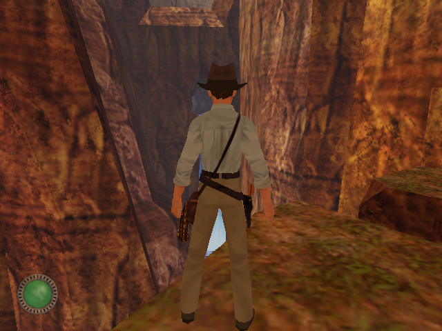
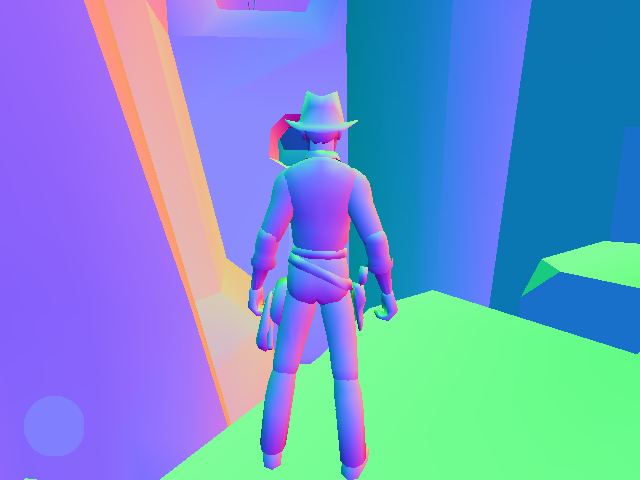

<div align="center">

# Jones3D EX
### An enhanced source port of the Jones3D engine


**[Roadmap](Docs/Roadmap.md)** • **[Architecture](Docs/arc42/README.md)** • **[Building](#building)** • **[Changelog](CHANGELOG.md)**

[](LICENSE)
[](Docs/arc42/09-decisions/ADR-0008-babylon-license.md)

</div>

## Overview

**Jones3D EX** is an enhanced source port of **Jones3D**, the engine of ***Indiana Jones and the Infernal
Machine*** (1999). Its goal is the original game on Windows, Linux and macOS, with a modern renderer and audio,
using the player's own game data and savegames.

It follows the model of the Kex engine behind Nightdive Studios' remasters: the restored original game logic
runs on a separate, game-agnostic platform framework. Here that framework is the **Babylon Engine**:

| Part | What it does | Language | License |
|---|---|---|---|
| Game | The restored Jones3D and Sith game logic: worlds, physics, AI, COG scripts, savegames | C11 | AGPL-3.0 |
| Babylon Engine | Window, input, timing, files, rendering, audio, settings, behind portable interfaces | C++ | MPL-2.0 |

Gameplay is measured against the original release: headless runs replay savegames with scripted input and
compare the simulation frame by frame. The quality-of-life changes inherited from OpenJones3D are on by
default, and each can be switched back to retail behavior. Presentation is free to improve.

This repository does **not** include any game assets. You need a legal copy of the game, for example from
[Steam](https://store.steampowered.com/app/904540) or [GOG](https://www.gog.com/en/game/indiana_jones_and_the_infernal_machine).

## Status

Jones3D EX is at the start of its own road. See the [roadmap](Docs/Roadmap.md).

- **Runs headless today:** on Linux and other systems, 32-bit and 64-bit, and on 64-bit Windows, without a
  window or sound. This is what the behavior checks use.
- **Renders the game:** the Babylon column draws the 3D scene, the 2D layer, HUD and console text, and the intro
  movie on Vulkan, Direct3D 12 or Metal, whichever the system provides.
- **Playable:** the windowed Babylon build plays with sound (through miniaudio), saving with thumbnails and
  the in-game menus. The Win32 and DirectX 9 build inherited from OpenJones3D is gone
  ([ADR-0011](Docs/arc42/09-decisions/ADR-0011-retire-win32-directx.md)).
- **Next:** an owner play-test on a real display, speakers and gamepad, then the M8 release.

## The Babylon Engine

Babylon lives in [`Babylon/`](Babylon/README.md) and knows nothing about Jones3D: it never includes game code
and never names a game concept, so it can be built and tested on its own. It is a set of small modules, each one
CMake target that hides one platform decision:

| Module | What it hides |
|---|---|
| `core`, `log` | Assertions, version, logging with pluggable sinks |
| `time` | The clock; the Null clock steps a fixed amount per frame, which keeps headless runs deterministic |
| `files` | Host file access, the base path and the per-user writable directory |
| `platform`, `input` | Windows and OS events, and the per-frame input state built from them |
| `cvars` | Named, typed settings with defaults, ranges and change callbacks |
| `render` | The GPU: textures, buffers, pipelines and one command list per frame, on SDL3 GPU (Vulkan, Direct3D 12, Metal) |
| `audio` | The sound device: output device choice, sounds, voices, 3D and streaming voices, on miniaudio with a Null backend |
| `ui` | Menu screens: widgets, layout, focus, keyboard/mouse/gamepad navigation and cvar binding |

Each module that touches the system has an SDL3 backend and a Null backend that keeps the same contract without a
device. The game reaches Babylon through a thin adapter in `Libs/std`, which keeps the original function names and behavior, so
the restored code above it barely changes. Tests run each interface against every backend; the render
tests also run on a software Vulkan driver in CI. The rules are in
[Babylon-Design-Rules.md](Docs/arc42/08-crosscutting/Babylon-Design-Rules.md) and the
[decisions](Docs/arc42/09-decisions/README.md).

### What the new renderer adds

The original engine lights the world on the CPU, one brightness value per vertex, and the GPU only blends those
values across each triangle. The Babylon renderer draws the same picture, and also receives the direction every
surface faces (its normal). The right image shows that second output, with direction encoded as colour: floors
facing up are green, walls show their orientation, and Indy is shaded smoothly from his model's normals.

| What you see | What the renderer also knows |
|---|---|
|  |  |

With normals per pixel, lights can be computed per pixel instead of per vertex, and corners and crevices can be
darkened by screen-space ambient occlusion. Both are planned for a later milestone. The picture itself doesn't
change: frames rendered with this output on and off are identical, and the classic look stays the reference.

## Where it comes from

Jones3D EX is a hard fork of [OpenJones3D](https://github.com/smlu/OpenJones3D), which rebuilt the engine
function by function from the retail executable, using IDA, Ghidra, debug symbols and related projects such as
[OpenJKDF2](https://github.com/shinyquagsire23/OpenJKDF2). OpenJones3D completed that reconstruction. Its
compatibility rules (hooks into the original executable, retail addresses, frozen memory layouts) existed to
check it, and are dropped here so the engine can move onto a new platform layer. The last state compatible
with OpenJones3D is tagged `upstream-compatible-final`. The reasons are in
[ADR-0001](Docs/arc42/09-decisions/ADR-0001-hard-fork.md) and
[ADR-0004](Docs/arc42/09-decisions/ADR-0004-drop-binary-compatibility.md).

Inherited from OpenJones3D, among others: widescreen and high resolutions (in its DirectX 9 renderer, which
the Babylon renderer replaces), `Jones.cfg` instead of the Windows Registry, high-precision frame timing, more
sound channels, restored console commands and COG functions, and many bug and crash fixes. See
[CHANGELOG.md](CHANGELOG.md).

<a id="building"></a>
## Building

CMake 3.15 or newer is required.

### Linux and other systems (headless)

```bash
cmake -S . -B build/native -G Ninja -DCMAKE_C_COMPILER=clang -DCMAKE_CXX_COMPILER=clang++ -DCMAKE_BUILD_TYPE=Debug
cmake --build build/native
ctest --test-dir build/native --output-on-failure -L unit
```

This builds the unit tests and `Jones3D-headless`, which runs the game without window or sound:

```bash
cd <game>/Resource
<repo>/build/native/Jones3D/Jones3D-headless --load ../SaveGames/<save>.nds --frames 1000 --state state.txt
```

Clang is the tested compiler. GCC works but needs extra flags for now, see
[chapter 11](Docs/arc42/11-risks-and-technical-debt.md). More build profiles and the test workflow are in [Docs/Testing.md](Docs/Testing.md).

### Windows (64-bit)

Windows builds the Babylon column, as a 64-bit program only. With Visual Studio:

```bat
cmake -S . -B build -G "Visual Studio 18 2026" -A x64 -DJONES3D_PLATFORM_BABYLON=ON
cmake --build build --config Release
```

With MinGW-w64 (x86_64), from a Linux host:

```bash
cmake -S . -B build/win64 -G Ninja -DCMAKE_TOOLCHAIN_FILE=cmake/mingw-x86_64.cmake -DCMAKE_BUILD_TYPE=Release
cmake --build build/win64
```

Both produce `Jones3D-headless.exe` and the windowed `Jones3D.exe`, which plays the game with sound, saving
and the in-game menus. 32-bit Windows is not supported.

## Documentation

- [Architecture (arc42)](Docs/arc42/README.md): goals, constraints, building blocks, runtime, decisions
- [Roadmap](Docs/Roadmap.md): milestones and status
- [File formats](Docs/Formats/README.md), [COG scripting](Docs/COG/README.md), [Jones.cfg](Docs/Jones.cfg.md)
- [CONTRIBUTING.md](CONTRIBUTING.md): workflow, code style, commits
- [Testing.md](Docs/Testing.md): tests and how to run them

## License

The game code is licensed under the [GNU Affero General Public License v3.0](LICENSE), copyright OpenJones3D
contributors. The Babylon Engine in `Babylon/` is licensed separately under the Mozilla Public License 2.0, see
[ADR-0008](Docs/arc42/09-decisions/ADR-0008-babylon-license.md).

*Indiana Jones and the Infernal Machine* is © Lucasfilm Ltd. LucasArts, Indiana Jones and related properties are
trademarks of Lucasfilm Ltd. Jones3D EX is not affiliated with or endorsed by Lucasfilm, LucasArts, Disney or
Nightdive Studios.
